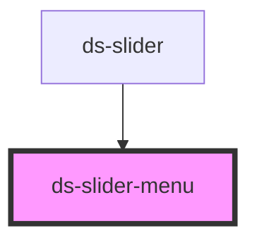

# ds-slider-menu

<!-- Auto Generated Below -->

## Properties

| Property             | Attribute          | Description | Type     | Default |
| -------------------- | ------------------ | ----------- | -------- | ------- |
| `dsCurrentItemIndex` | `currentitemindex` |             | `number` | `0`     |
| `dsItemCount`        | `itemcount`        |             | `number` | `0`     |

## Events

| Event                             | Description | Type               |
| --------------------------------- | ----------- | ------------------ |
| `request_displaySliderItem_event` |             | `CustomEvent<any>` |

## Dependencies

### Used by

 - [ds-slider](..)

### Graph

----------------------------------------------

*Built with [StencilJS](https://stenciljs.com/)*
