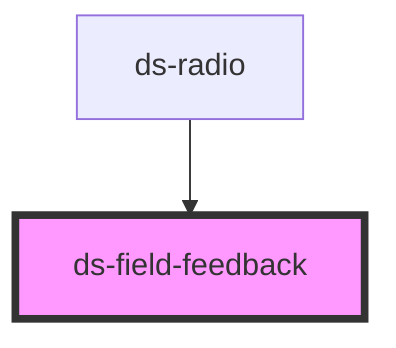

# ds-field-feedback

<!-- Auto Generated Below -->

## Overview

This component display a message with a level for the input forms

## Properties

| Property  | Attribute | Description | Type                                                                 | Default               |
| --------- | --------- | ----------- | -------------------------------------------------------------------- | --------------------- |
| `level`   | `level`   |             | `FeedbackLevel.ERROR \| FeedbackLevel.INFO \| FeedbackLevel.WARNING` | `FeedbackLevel.ERROR` |
| `message` | `message` |             | `string`                                                             | `undefined`           |

## Dependencies

### Used by

 - [ds-radio](../radio)

### Graph

----------------------------------------------

*Built with [StencilJS](https://stenciljs.com/)*
