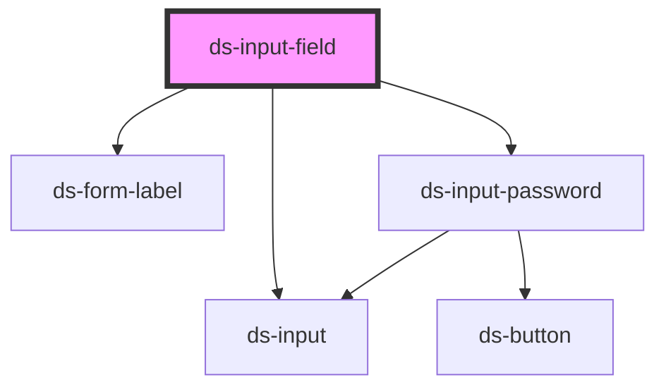

# ds-input-field

<!-- Auto Generated Below -->

## Properties

| Property           | Attribute           | Description                                                                                                                                                                                                                                    | Type                                                                      | Default                |
| ------------------ | ------------------- | ---------------------------------------------------------------------------------------------------------------------------------------------------------------------------------------------------------------------------------------------- | ------------------------------------------------------------------------- | ---------------------- |
| `errorMessage`     | `error-message`     |                                                                                                                                                                                                                                                | `string`                                                                  | `undefined`            |
| `icon`             | `icon`              |                                                                                                                                                                                                                                                | `string`                                                                  | `undefined`            |
| `inputId`          | `input-id`          |                                                                                                                                                                                                                                                | `string`                                                                  | `undefined`            |
| `inputName`        | `input-name`        |                                                                                                                                                                                                                                                | `string`                                                                  | `undefined`            |
| `inputPlaceholder` | `input-placeholder` |                                                                                                                                                                                                                                                | `string`                                                                  | `undefined`            |
| `inputType`        | `input-type`        |                                                                                                                                                                                                                                                | `InputFieldType.INPUT \| InputFieldType.PASSWORD \| InputFieldType.PHONE` | `InputFieldType.INPUT` |
| `isDisabled`       | `is-disabled`       |                                                                                                                                                                                                                                                | `boolean`                                                                 | `undefined`            |
| `isInError`        | `is-in-error`       |                                                                                                                                                                                                                                                | `boolean`                                                                 | `undefined`            |
| `label`            | `label`             |                                                                                                                                                                                                                                                | `string`                                                                  | `undefined`            |
| `max`              | `max`               |                                                                                                                                                                                                                                                | `number`                                                                  | `undefined`            |
| `min`              | `min`               |                                                                                                                                                                                                                                                | `number`                                                                  | `undefined`            |
| `sendValue`        | `send-value`        | Send data with an event                                                                                                                                                                                                                        | `boolean`                                                                 | `true`                 |
| `type`             | `type`              |                                                                                                                                                                                                                                                | `string`                                                                  | `'text'`               |
| `validators`       | --                  | A table of validators to validate the form field and theirs error messages. The error messages from the component implementing the form field. If no error messages are passed, default values will be used from the translations Can be empty | `Validator[]`                                                             | `[]`                   |
| `value`            | `value`             |                                                                                                                                                                                                                                                | `string`                                                                  | `undefined`            |

## Events

| Event                       | Description | Type                                            |
| --------------------------- | ----------- | ----------------------------------------------- |
| `clickButtonHandler`        |             | `CustomEvent<any>`                              |
| `notify_fieldChanged_event` |             | `CustomEvent<{ value: string; name: string; }>` |

## Dependencies

### Depends on

- [ds-form-label](../../label)
- [ds-input](../../input/input)
- [ds-input-password](../../input/password)

### Graph

----------------------------------------------

*Built with [StencilJS](https://stenciljs.com/)*
