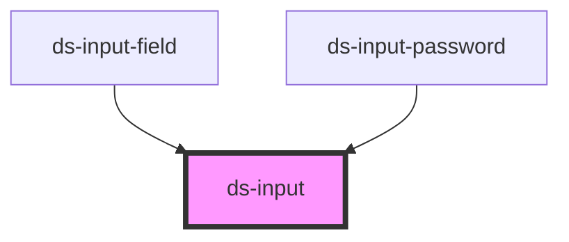

# ds-input

<!-- Auto Generated Below -->

## Properties

| Property       | Attribute      | Description | Type                 | Default     |
| -------------- | -------------- | ----------- | -------------------- | ----------- |
| `autocomplete` | `autocomplete` |             | `string`             | `'on'`      |
| `inputId`      | `input-id`     |             | `string`             | `undefined` |
| `inputName`    | `input-name`   |             | `string`             | `undefined` |
| `isDisabled`   | `is-disabled`  |             | `boolean`            | `undefined` |
| `isInError`    | `is-in-error`  |             | `boolean`            | `undefined` |
| `max`          | `max`          |             | `number`             | `undefined` |
| `min`          | `min`          |             | `number`             | `undefined` |
| `mods`         | `mods`         |             | `string \| string[]` | `''`        |
| `placeholder`  | `placeholder`  |             | `string`             | `''`        |
| `type`         | `type`         |             | `string`             | `'text'`    |
| `value`        | `value`        |             | `any`                | `undefined` |

## Events

| Event         | Description | Type               |
| ------------- | ----------- | ------------------ |
| `dSInput`     |             | `CustomEvent<any>` |
| `dSInputBlur` |             | `CustomEvent<any>` |
| `dSKeyDown`   |             | `CustomEvent<any>` |
| `dSKeyUp`     |             | `CustomEvent<any>` |

## Dependencies

### Used by

 - [ds-input-field](../../field/input)
 - [ds-input-password](../password)

### Graph

----------------------------------------------

*Built with [StencilJS](https://stenciljs.com/)*
