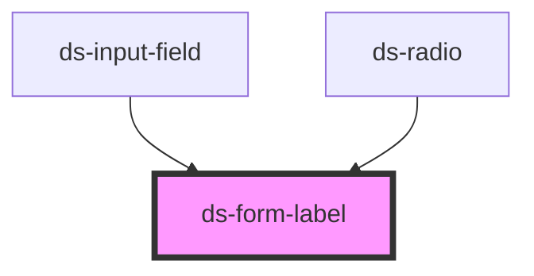

# ds-form-label

<!-- Auto Generated Below -->

## Overview

This component define a form label (for input, select etc..)

## Properties

| Property     | Attribute     | Description | Type      | Default     |
| ------------ | ------------- | ----------- | --------- | ----------- |
| `fieldLabel` | `field-label` |             | `string`  | `undefined` |
| `isInError`  | `is-in-error` |             | `boolean` | `undefined` |
| `isRequired` | `is-required` |             | `boolean` | `undefined` |

## Events

| Event        | Description | Type               |
| ------------ | ----------- | ------------------ |
| `clickLabel` |             | `CustomEvent<any>` |

## Dependencies

### Used by

 - [ds-input-field](../field/input)
 - [ds-radio](../radio)

### Graph

----------------------------------------------

*Built with [StencilJS](https://stenciljs.com/)*
