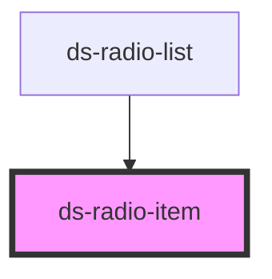

# ds-radio-item

<!-- Auto Generated Below -->

## Overview

This component define a radio item.

## Properties

| Property              | Attribute                | Description | Type                                                   | Default                   |
| --------------------- | ------------------------ | ----------- | ------------------------------------------------------ | ------------------------- |
| `isChecked`           | `is-checked`             |             | `boolean`                                              | `undefined`               |
| `label`               | `label`                  |             | `string`                                               | `undefined`               |
| `name`                | `name`                   |             | `string`                                               | `undefined`               |
| `radioId`             | `radio-id`               |             | `string`                                               | `undefined`               |
| `radioItemCheckStyle` | `radio-item-check-style` |             | `RadioItemCheckStyle.CHECK \| RadioItemCheckStyle.DOT` | `RadioItemCheckStyle.DOT` |
| `radioItemStyle`      | `radio-item-style`       |             | `RadioItemStyle.ROUND \| RadioItemStyle.SQUARE`        | `RadioItemStyle.ROUND`    |
| `value`               | `value`                  |             | `string`                                               | `undefined`               |

## Events

| Event                           | Description | Type               |
| ------------------------------- | ----------- | ------------------ |
| `notify_radioItemChecked_event` |             | `CustomEvent<any>` |

## Dependencies

### Used by

 - [ds-radio-list](../list)

### Graph

----------------------------------------------

*Built with [StencilJS](https://stenciljs.com/)*
