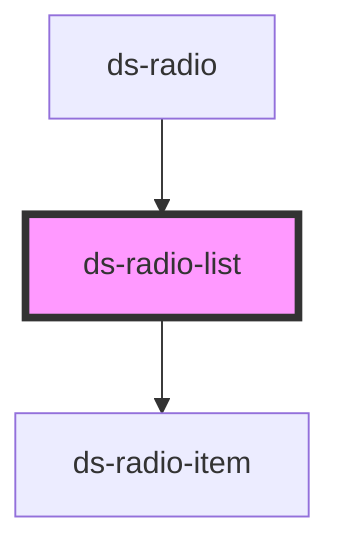

# ds-radio-list

<!-- Auto Generated Below -->

## Overview

This component define a list of radio items.

## Properties

| Property              | Attribute                | Description | Type                                                   | Default     |
| --------------------- | ------------------------ | ----------- | ------------------------------------------------------ | ----------- |
| `itemList`            | --                       |             | `RadioItem[]`                                          | `[]`        |
| `radioItemCheckStyle` | `radio-item-check-style` |             | `RadioItemCheckStyle.CHECK \| RadioItemCheckStyle.DOT` | `undefined` |
| `radioItemStyle`      | `radio-item-style`       |             | `RadioItemStyle.ROUND \| RadioItemStyle.SQUARE`        | `undefined` |

## Events

| Event                            | Description | Type               |
| -------------------------------- | ----------- | ------------------ |
| `notify_radioItemSelected_event` |             | `CustomEvent<any>` |

## Dependencies

### Used by

 - [ds-radio](..)

### Depends on

- [ds-radio-item](../item)

### Graph

----------------------------------------------

*Built with [StencilJS](https://stenciljs.com/)*
