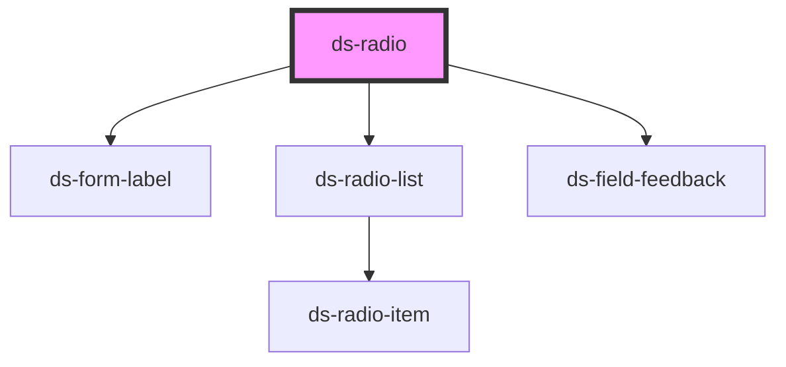

# ds-radio

<!-- Auto Generated Below -->

## Properties

| Property              | Attribute                | Description                                                                                                                                                                                                                                    | Type                                                   | Default     |
| --------------------- | ------------------------ | ---------------------------------------------------------------------------------------------------------------------------------------------------------------------------------------------------------------------------------------------- | ------------------------------------------------------ | ----------- |
| `itemList`            | --                       |                                                                                                                                                                                                                                                | `RadioItem[]`                                          | `[]`        |
| `label`               | `label`                  |                                                                                                                                                                                                                                                | `string`                                               | `undefined` |
| `mods`                | --                       |                                                                                                                                                                                                                                                | `string[]`                                             | `[]`        |
| `radioId`             | `radio-id`               |                                                                                                                                                                                                                                                | `string`                                               | `undefined` |
| `radioItemCheckStyle` | `radio-item-check-style` |                                                                                                                                                                                                                                                | `RadioItemCheckStyle.CHECK \| RadioItemCheckStyle.DOT` | `undefined` |
| `radioItemStyle`      | `radio-item-style`       |                                                                                                                                                                                                                                                | `RadioItemStyle.ROUND \| RadioItemStyle.SQUARE`        | `undefined` |
| `validators`          | --                       | A table of validators to validate the form field and theirs error messages. The error messages from the component implementing the form field. If no error messages are passed, default values will be used from the translations Can be empty | `Validator[]`                                          | `[]`        |

## Events

| Event                             | Description | Type               |
| --------------------------------- | ----------- | ------------------ |
| `notify_radioValueSelected_event` |             | `CustomEvent<any>` |

## Dependencies

### Depends on

- [ds-form-label](../label)
- [ds-radio-list](list)
- [ds-field-feedback](../feedback)

### Graph

----------------------------------------------

*Built with [StencilJS](https://stenciljs.com/)*
