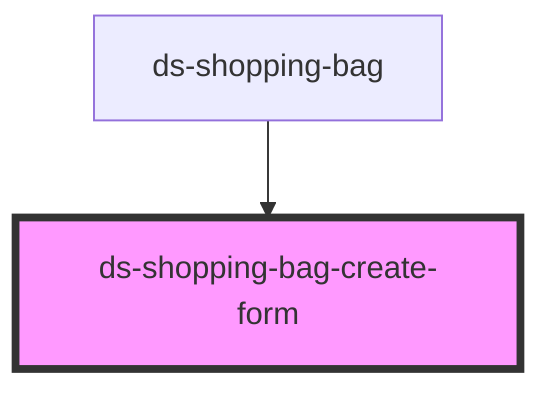

# ds-shopping-bag-create-form

<!-- Auto Generated Below -->

## Overview

Create shopping bag form

## Properties

| Property                   | Attribute                     | Description                                           | Type     | Default     |
| -------------------------- | ----------------------------- | ----------------------------------------------------- | -------- | ----------- |
| `locale`                   | `locale`                      | Locale used for translations                          | `string` | `'en'`      |
| `requestCreateShoppingBag` | `request-create-shopping-bag` | Parent component method called when form is submitted | `any`    | `undefined` |
| `requestHideCreateForm`    | `request-hide-create-form`    | Parent component method called to hide creation form  | `any`    | `undefined` |

## Dependencies

### Used by

 - [ds-shopping-bag](..)

### Graph

----------------------------------------------

*Built with [StencilJS](https://stenciljs.com/)*
