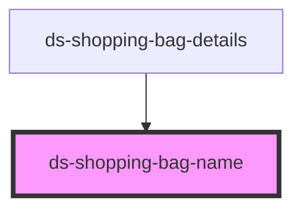

# ds-shopping-bag-name

<!-- Auto Generated Below -->

## Overview

Component used to display and edit shopping bag name

## Properties

| Property                   | Attribute                     | Description                                                | Type         | Default     |
| -------------------------- | ----------------------------- | ---------------------------------------------------------- | ------------ | ----------- |
| `isDisabled`               | `disabled`                    | Wether shopping bag name is editable or not                | `boolean`    | `false`     |
| `locale`                   | `locale`                      | Locale used for transaltions                               | `string`     | `"en"`      |
| `name`                     | `name`                        | Shopping bag name to display/edit                          | `string`     | `""`        |
| `requestUpdateShoppingBag` | `request-update-shopping-bag` | Parent component method called to update shopping bag name | `any`        | `undefined` |
| `toggleDeleteMessage`      | --                            |                                                            | `() => void` | `undefined` |

## Dependencies

### Used by

 - [ds-shopping-bag-details](../shopping-bag-details)

### Graph

----------------------------------------------

*Built with [StencilJS](https://stenciljs.com/)*
