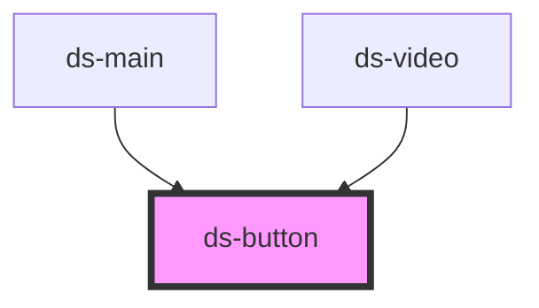

# ds-button

A native `<button>`, or a link (`<a>`) when `href` is set, skinned by the theme's `.ds-button` rules: sizes
(`xs`, `sm`, `md`, `lg`, `xl`), `rounded`, `shadow`, and colors (`stl-1`, `stl-2`, `stl-3`) as modifiers.

```html
<ds-button mods="md,stl-1" type="submit">Save</ds-button>

<ds-button mods="sm,stl-2" href="/docs">
  <ds-icon type="help" slot="before"></ds-icon>
  Documentation
</ds-button>

<ds-button mods="sm,stl-3" label="Close"><ds-icon type="cancel"></ds-icon></ds-button>
```

Listen to `click` on the component as on a native button (`onClick` in JSX). While `disabled`, no click reaches these
listeners: the component stops the clicks in the capture phase of the host (and on the inner button or link), and
calls `preventDefault()`. A disabled link also loses its `href`, gets `role="link"`, `aria-disabled="true"` and
`tabindex="-1"`.

`href` is read when the component loads to choose between a link and a button: later changes update the URL of a
link, but do not swap the elements (Stencil would lose the slotted content).

`ds-trigger type="button"` also renders the `.ds-button` class, on an element that is not a native button: use it to
call a method of another element (`target`, `action`), and `ds-button` for a button or a link.

<!-- Auto Generated Below -->


## Overview

A button, or a link styled as a button when `href` is set. The host carries the `ds-button` class and the
modifiers (`mods`); it renders a native `<button>` (or `<a>`) holding the `before`, default and `after` slots.
In the light DOM, a `type="submit"` button inside a `<form>` submits it.

`href` chooses between a link and a button when the component loads: Stencil loses the slotted content of an
element it replaces in the light DOM, so the component never swaps one for the other afterwards.

A disabled button does not dispatch clicks: the native button is disabled, a link loses its `href` (and gets
`aria-disabled="true"` and `tabindex="-1"`), and a click on the component is stopped before it reaches the
listeners of the host (such as `onClick` in JSX) or of its ancestors.

## Properties

| Property   | Attribute  | Description                                                                                                                                                                                                                 | Type                              | Default     |
| ---------- | ---------- | --------------------------------------------------------------------------------------------------------------------------------------------------------------------------------------------------------------------------- | --------------------------------- | ----------- |
| `disabled` | `disabled` | Disables the button or the link, and stops the clicks on the component.                                                                                                                                                     | `boolean`                         | `false`     |
| `href`     | `href`     | Renders a link (`<a>`) to this URL instead of a button. Read when the component loads to choose between a link and a button: afterwards, it changes the URL of a link, but a button stays a button and a link stays a link. | `string`                          | `undefined` |
| `label`    | `label`    | Accessible name of the button or link (its `aria-label`), for a button without text, such as an icon-only button.                                                                                                           | `string`                          | `undefined` |
| `mods`     | `mods`     | Comma-separated list (or array) of modifiers, rendered as `--<modifier>` classes on the component.                                                                                                                          | `string \| string[]`              | `[]`        |
| `rel`      | `rel`      | `rel` of the link (with `href`).                                                                                                                                                                                            | `string`                          | `undefined` |
| `target`   | `target`   | `target` of the link (with `href`).                                                                                                                                                                                         | `string`                          | `undefined` |
| `type`     | `type`     | Type of the native button: `button`, `submit` or `reset` (any other value gives `button`). Not used with `href`.                                                                                                            | `"button" \| "reset" \| "submit"` | `'button'`  |


## Slots

| Slot       | Description                                |
| ---------- | ------------------------------------------ |
|            | The label.                                 |
| `"after"`  | Content after the label.                   |
| `"before"` | Content before the label, such as an icon. |


## Dependencies

### Used by

 - [ds-main](../../demo)
 - [ds-video](../video)

### Graph


----------------------------------------------

*Built with [StencilJS](https://stenciljs.com/)*
