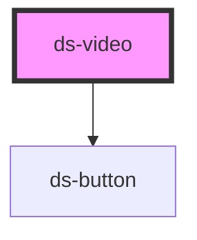

# ds-video

<!-- Auto Generated Below -->

## Overview

A video player. The host has the `--playing` class while the video plays, `--paused` once paused, neither when
stopped (`stop()`), and `--muted` while muted. When the browser refuses to play, it keeps its former state (see `playError`).

## Properties

| Property      | Attribute     | Description                                                                                        | Type                 | Default     |
| ------------- | ------------- | -------------------------------------------------------------------------------------------------- | -------------------- | ----------- |
| `autoplay`    | `autoplay`    |                                                                                                    | `boolean`            | `false`     |
| `controls`    | `controls`    |                                                                                                    | `boolean`            | `false`     |
| `loop`        | `loop`        |                                                                                                    | `boolean`            | `false`     |
| `mods`        | `mods`        | Comma-separated list (or array) of modifiers, rendered as `--<modifier>` classes on the component. | `string \| string[]` | `[]`        |
| `playsinline` | `playsinline` |                                                                                                    | `boolean`            | `false`     |
| `poster`      | `poster`      |                                                                                                    | `string`             | `undefined` |
| `sources`     | `sources`     |                                                                                                    | `string \| string[]` | `[]`        |

## Events

| Event       | Description                                                                                                                                                                                                                                                                                                                     | Type                               |
| ----------- | ------------------------------------------------------------------------------------------------------------------------------------------------------------------------------------------------------------------------------------------------------------------------------------------------------------------------------- | ---------------------------------- |
| `playError` | Emitted when the browser refuses to play the video (the promise of the player's `play()` is rejected), for example with a `NotAllowedError` when autoplay is blocked. The component is then back to its state before the call: not playing. Detail: `{ error }`. A `play()` interrupted by `pause()` or `stop()` emits nothing. | `CustomEvent<{ error: unknown; }>` |

## Methods

### `mute() => Promise<void>`

#### Returns

Type: `Promise<void>`

### `pause() => Promise<void>`

#### Returns

Type: `Promise<void>`

### `play() => Promise<void>`

Plays the video. Resolves at once, without waiting for the player (which can wait for its source for ever):
a refusal of the player is reported with `playError`.

#### Returns

Type: `Promise<void>`

### `stop() => Promise<void>`

Stops the video: paused, back to the beginning, reloaded. Neither `--playing` nor `--paused`.

#### Returns

Type: `Promise<void>`

### `unmute() => Promise<void>`

#### Returns

Type: `Promise<void>`

## Dependencies

### Depends on

- [ds-button](../button)

### Graph

----------------------------------------------

*Built with [StencilJS](https://stenciljs.com/)*
