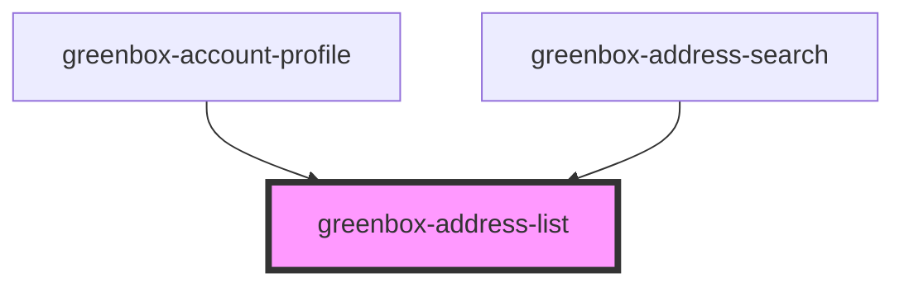

# greenbox-address-list

<!-- Auto Generated Below -->

## Properties

| Property    | Attribute | Description | Type     | Default  |
| ----------- | --------- | ----------- | -------- | -------- |
| `addresses` | --        |             | `any[]`  | `[]`     |
| `mode`      | `mode`    |             | `string` | `"view"` |

## Events

| Event                                  | Description | Type               |
| -------------------------------------- | ----------- | ------------------ |
| `addressList_notice_addressSet_event`  |             | `CustomEvent<any>` |
| `addressList_request_newAddress_event` |             | `CustomEvent<any>` |

## Dependencies

### Used by

 - [greenbox-account-profile](../../greenbox-account/greenbox-account-profile)
 - [greenbox-address-search](../greenbox-address-search)

### Graph

----------------------------------------------

*Built with [StencilJS](https://stenciljs.com/)*
