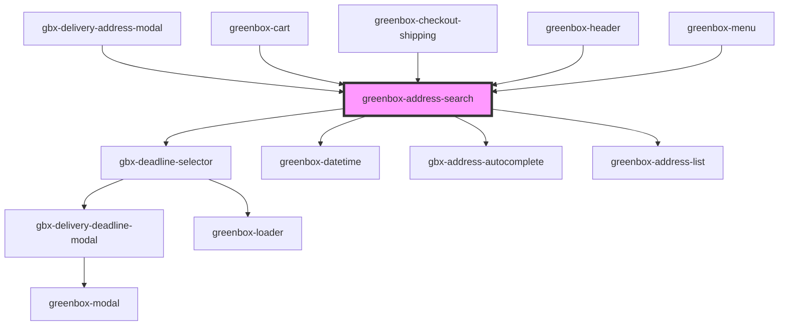

# greenbox-address

<!-- Auto Generated Below -->

## Properties

| Property                             | Attribute                             | Description | Type      | Default          |
| ------------------------------------ | ------------------------------------- | ----------- | --------- | ---------------- |
| `accuracyLevel`                      | `accuracy-level`                      |             | `number`  | `4`              |
| `accuracyRequired`                   | `accuracy-required`                   |             | `string`  | `"streetNumber"` |
| `autocomplete`                       | `autocomplete`                        |             | `any`     | `null`           |
| `autocomplete_componentRestrictions` | `autocomplete_component-restrictions` |             | `string`  | `"ch"`           |
| `autocomplete_delay`                 | `autocomplete_delay`                  |             | `number`  | `250`            |
| `autocomplete_minchar`               | `autocomplete_minchar`                |             | `number`  | `7`              |
| `displayMode`                        | `display-mode`                        |             | `string`  | `"large"`        |
| `estimation`                         | `estimation`                          |             | `number`  | `undefined`      |
| `mode`                               | `mode`                                |             | `string`  | `"geolocate"`    |
| `newAddressMode`                     | `new-address-mode`                    |             | `boolean` | `false`          |
| `place`                              | `place`                               |             | `any`     | `null`           |

## Dependencies

### Used by

 - [gbx-delivery-address-modal](../../app/shop/modal/delivery-address-modal)
 - [greenbox-cart](../../greenbox-cart)
 - [greenbox-checkout-shipping](../../greenbox-checkout/greenbox-checkout-shipping)
 - [greenbox-header](../../greenbox-header)
 - [greenbox-menu](../../greenbox-menu)

### Depends on

- [gbx-deadline-selector](../../toolkit/deadline-selector)
- [greenbox-datetime](../../greenbox-datetime)
- [gbx-address-autocomplete](../../toolkit/address-autocomplete)
- [greenbox-address-list](../greenbox-address-list)

### Graph

----------------------------------------------

*Built with [StencilJS](https://stenciljs.com/)*
