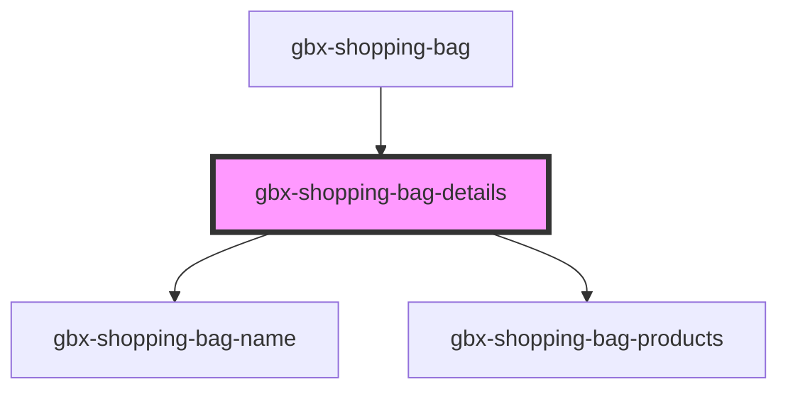

# gbx-shopping-bag-details

<!-- Auto Generated Below -->

## Overview

Display shopping bag details & products

## Properties

| Property                           | Attribute                              | Description                                                        | Type      | Default     |
| ---------------------------------- | -------------------------------------- | ------------------------------------------------------------------ | --------- | ----------- |
| `isAgeLegal`                       | `is-age-legal`                         | Variable to know if the user already answer to confirm-age's modal | `boolean` | `false`     |
| `locale`                           | `locale`                               | Locale used for translations                                       | `string`  | `'en'`      |
| `requestDeleteShoppingBagProducts` | `request-delete-shopping-bag-products` | Method called to delete current shopping bag                       | `any`     | `undefined` |
| `requestNavigationBack`            | `request-navigation-back`              | Method called to navigate to shopping bag root page                | `any`     | `undefined` |
| `requestUpdateShoppingBag`         | `request-update-shopping-bag`          | Method called to update shopping bag informations                  | `any`     | `undefined` |
| `shoppingBag`                      | `shopping-bag`                         | Shopping bag to show details of                                    | `any`     | `{}`        |

## Dependencies

### Used by

 - [gbx-shopping-bag](..)

### Depends on

- [gbx-shopping-bag-name](../shopping-bag-name)
- [gbx-shopping-bag-products](../shopping-bag-products)

### Graph

----------------------------------------------

*Built with [StencilJS](https://stenciljs.com/)*
