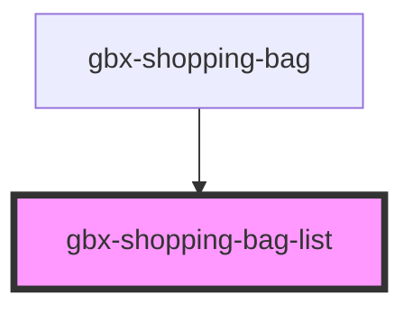

# gbx-shopping-bag-list

<!-- Auto Generated Below -->

## Overview

Display a shopping bag list

## Properties

| Property                    | Attribute                      | Description                                         | Type     | Default     |
| --------------------------- | ------------------------------ | --------------------------------------------------- | -------- | ----------- |
| `locale`                    | `locale`                       | Locale used for translations                        | `string` | `'en'`      |
| `requestDisplayCreateForm`  | `request-display-create-form`  | Method called to display shopping bag creation form | `any`    | `undefined` |
| `requestDisplayShoppingBag` | `request-display-shopping-bag` | Method called to display shopping bag               | `any`    | `undefined` |
| `shoppingBags`              | --                             | An array containing all shopping bags to display    | `any[]`  | `[]`        |

## Dependencies

### Used by

 - [gbx-shopping-bag](..)

### Graph

----------------------------------------------

*Built with [StencilJS](https://stenciljs.com/)*
