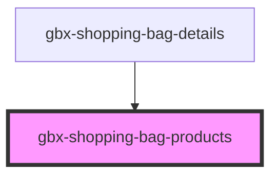

# gbx-shopping-bag-products

<!-- Auto Generated Below -->

## Properties

| Property                          | Attribute                             | Description                            | Type                          | Default     |
| --------------------------------- | ------------------------------------- | -------------------------------------- | ----------------------------- | ----------- |
| `ShoppingBagUpdateProductsAction` | `shopping-bag-update-products-action` |                                        | `any`                         | `undefined` |
| `products`                        | --                                    | Array of products to display           | `any[]`                       | `[]`        |
| `selectedProductIds`              | --                                    |                                        | `string[]`                    | `undefined` |
| `shoppingBagId`                   | `shopping-bag-id`                     | Shopping bag id associated to products | `string`                      | `undefined` |
| `toggleProductSelection`          | --                                    |                                        | `(productId: string) => void` | `undefined` |

## Dependencies

### Used by

 - [gbx-shopping-bag-details](../shopping-bag-details)

### Graph

----------------------------------------------

*Built with [StencilJS](https://stenciljs.com/)*
