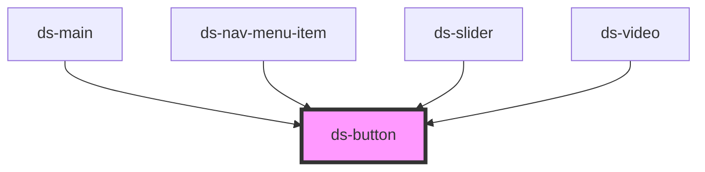

# ds-button

<!-- Auto Generated Below -->

## Properties

| Property   | Attribute  | Description | Type                                | Default     |
| ---------- | ---------- | ----------- | ----------------------------------- | ----------- |
| `color`    | `color`    |             | `string`                            | `undefined` |
| `disabled` | `disabled` |             | `boolean \| string`                 | `undefined` |
| `mods`     | `mods`     |             | `string \| string[]`                | `[]`        |
| `styles`   | `styles`   |             | `string`                            | `undefined` |
| `type`     | `type`     |             | `"button" \| "submit" \| "trigger"` | `'button'`  |
| `url`      | `url`      |             | `string`                            | `undefined` |

## Events

| Event           | Description | Type               |
| --------------- | ----------- | ------------------ |
| `dsButtonClick` |             | `CustomEvent<any>` |

## Dependencies

### Used by

 - [ds-main](../../..)
 - [ds-nav-menu-item](../nav-menu/nav-menu-item)
 - [ds-slider](../slider)
 - [ds-video](../video)

### Graph

----------------------------------------------

*Built with [StencilJS](https://stenciljs.com/)*
