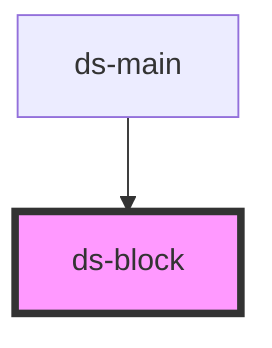

# ds-block

<!-- Auto Generated Below -->

## Properties

| Property | Attribute | Description                                                 | Type                 | Default     |
| -------- | --------- | ----------------------------------------------------------- | -------------------- | ----------- |
| `ext`    | `ext`     | Use to derivate the main class name                         | `string`             | `""`        |
| `mods`   | `mods`    | List of modifiers                                           | `string \| string[]` | `[]`        |
| `type`   | `type`    | Block type classname ( also used to build block classname ) | `string`             | `undefined` |

## Dependencies

### Used by

 - [ds-main](../..)

### Graph

----------------------------------------------

*Built with [StencilJS](https://stenciljs.com/)*
