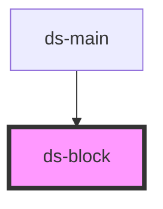

# ds-block

<!-- Auto Generated Below -->

## Properties

| Property  | Attribute | Description                                                 | Type                 | Default     |
| --------- | --------- | ----------------------------------------------------------- | -------------------- | ----------- |
| `article` | `article` |                                                             | `boolean`            | `undefined` |
| `block`   | `block`   |                                                             | `boolean`            | `undefined` |
| `ext`     | `ext`     | Use to derivate the main class name                         | `string`             | `undefined` |
| `form`    | `form`    |                                                             | `boolean`            | `undefined` |
| `mods`    | `mods`    | List of modifiers                                           | `string \| string[]` | `[]`        |
| `section` | `section` |                                                             | `boolean`            | `undefined` |
| `type`    | `type`    | Block type classname ( also used to build block classname ) | `string`             | `undefined` |

## Methods

### `getContext() => Promise<"" | "block" | "article" | "section" | "form">`

#### Returns

Type: `Promise<"" | "block" | "article" | "section" | "form">`

## Dependencies

### Used by

 - [ds-main](../..)

### Graph

----------------------------------------------

*Built with [StencilJS](https://stenciljs.com/)*
