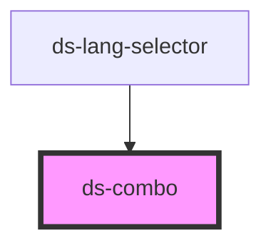

# ds-combo

<!-- Auto Generated Below -->

## Properties

| Property         | Attribute      | Description | Type                 | Default                                                        |
| ---------------- | -------------- | ----------- | -------------------- | -------------------------------------------------------------- |
| `customLabel`    | `custom-label` |             | `string`             | `""`                                                           |
| `mode`           | `mode`         |             | `string`             | `""`                                                           |
| `mods`           | `mods`         |             | `string \| string[]` | `[]`                                                           |
| `multiple`       | `multiple`     |             | `boolean`            | `false`                                                        |
| `name`           | `name`         |             | `string`             | `undefined`                                                    |
| `options`        | `options`      |             | `any`                | `undefined`                                                    |
| `overlay`        | `overlay`      |             | `boolean`            | `false`                                                        |
| `position`       | `position`     |             | `string`             | `"left"`                                                       |
| `selected`       | --             |             | `DSOption`           | `{     id: "",     index: -1,     name: "",     value: ""   }` |
| `selectedOption` | --             |             | `DSOption[]`         | `[]`                                                           |

## Events

| Event            | Description | Type               |
| ---------------- | ----------- | ------------------ |
| `optionSelected` |             | `CustomEvent<any>` |

## Methods

### `close() => Promise<void>`

#### Returns

Type: `Promise<void>`

### `open() => Promise<void>`

#### Returns

Type: `Promise<void>`

### `toggle(forceDisplay?: boolean) => Promise<void>`

#### Parameters

| Name           | Type      | Description |
| -------------- | --------- | ----------- |
| `forceDisplay` | `boolean` |             |

#### Returns

Type: `Promise<void>`

## Dependencies

### Used by

 - [ds-lang-selector](../../pronto/lang-selector)

### Graph

----------------------------------------------

*Built with [StencilJS](https://stenciljs.com/)*
