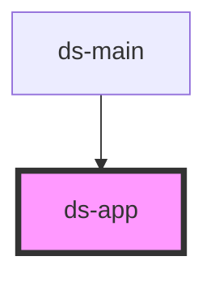

# ds-app

<!-- Auto Generated Below -->

## Properties

| Property              | Attribute             | Description | Type                       | Default                                 |
| --------------------- | --------------------- | ----------- | -------------------------- | --------------------------------------- |
| `breakpointsFromProp` | --                    |             | `{ [x: string]: number; }` | `undefined`                             |
| `debounceDelay`       | `debounce-delay`      |             | `number`                   | `500`                                   |
| `propertyName`        | `property-name`       |             | `string`                   | `'data-rsp'`                            |
| `subscriberSelector`  | `subscriber-selector` |             | `string`                   | `'[data-use-rsp]:not([data-rsp-init])'` |

## Events

| Event              | Description | Type               |
| ------------------ | ----------- | ------------------ |
| `breakpointChange` |             | `CustomEvent<any>` |

## Methods

### `buildQuery(queryParams: Record<string, unknown>) => Promise<string>`

Ajax

#### Parameters

| Name          | Type                        | Description |
| ------------- | --------------------------- | ----------- |
| `queryParams` | `{ [x: string]: unknown; }` |             |

#### Returns

Type: `Promise<string>`

### `get(url: string, queryParams?: Record<string, unknown>) => Promise<unknown>`

#### Parameters

| Name          | Type                        | Description |
| ------------- | --------------------------- | ----------- |
| `url`         | `string`                    |             |
| `queryParams` | `{ [x: string]: unknown; }` |             |

#### Returns

Type: `Promise<unknown>`

### `getBreakpoint(rawBreakpoints: { [label: string]: number[]; }) => Promise<Breakpoint>`

Get the current breakpoint

#### Parameters

| Name             | Type                             | Description                             |
| ---------------- | -------------------------------- | --------------------------------------- |
| `rawBreakpoints` | `{ [label: string]: number[]; }` | JSON Object containings all breakpoints |

#### Returns

Type: `Promise<Breakpoint>`

current breakpoint ( label & limits )

### `getBreakpoints() => Promise<Breakpoints>`

#### Returns

Type: `Promise<Breakpoints>`

### `getCurrentBreakpoint() => Promise<Breakpoint>`

#### Returns

Type: `Promise<Breakpoint>`

### `getData() => Promise<{ breakpoints: Breakpoints; }>`

#### Returns

Type: `Promise<{ breakpoints: Breakpoints; }>`

### `getParamsForBreakpoint<T>(currentBreakpoint: Breakpoint, params: { [breakpointLabel: string]: T; }) => Promise<T>`

#### Parameters

| Name                | Type                                | Description |
| ------------------- | ----------------------------------- | ----------- |
| `currentBreakpoint` | `Breakpoint`                        |             |
| `params`            | `{ [breakpointLabel: string]: T; }` |             |

#### Returns

Type: `Promise<T>`

### `getStylesJSON() => Promise<SassStyles>`

#### Returns

Type: `Promise<SassStyles>`

### `getSubscribers() => Promise<Element[]>`

#### Returns

Type: `Promise<Element[]>`

### `loadScript(scriptUrl: string, scriptId: string) => Promise<unknown>`

#### Parameters

| Name        | Type     | Description |
| ----------- | -------- | ----------- |
| `scriptUrl` | `string` |             |
| `scriptId`  | `string` |             |

#### Returns

Type: `Promise<unknown>`

### `post(url: string, payload?: string | Record<string, string> | string[][] | URLSearchParams) => Promise<any>`

#### Parameters

| Name      | Type                                                                | Description |
| --------- | ------------------------------------------------------------------- | ----------- |
| `url`     | `string`                                                            |             |
| `payload` | `string \| string[][] \| URLSearchParams \| Record<string, string>` |             |

#### Returns

Type: `Promise<any>`

### `processBreakpoints(breakpoints: RawBreakpoint) => Promise<Breakpoints>`

#### Parameters

| Name          | Type            | Description |
| ------------- | --------------- | ----------- |
| `breakpoints` | `RawBreakpoint` |             |

#### Returns

Type: `Promise<Breakpoints>`

### `propGetClassList(mainClass: string | string[], mods?: string | string[]) => Promise<Record<string, boolean>>`

Generate an css class ready object

#### Parameters

| Name        | Type                 | Description                                                                         |
| ----------- | -------------------- | ----------------------------------------------------------------------------------- |
| `mainClass` | `string \| string[]` | one or many classes to add to the object                                            |
| `mods`      | `string \| string[]` | one or many string which will be converted to modifier classes to add to the object |

#### Returns

Type: `Promise<Record<string, boolean>>`

Record<string, boolean>

### `propToBool(prop: string | boolean) => Promise<boolean>`

Convert an HTML property to a boolean

#### Parameters

| Name   | Type                | Description |
| ------ | ------------------- | ----------- |
| `prop` | `string \| boolean` |             |

#### Returns

Type: `Promise<boolean>`

boolean

### `propToFloat(prop: string | number) => Promise<number>`

Convert an HTML property to a float

#### Parameters

| Name   | Type               | Description |
| ------ | ------------------ | ----------- |
| `prop` | `string \| number` |             |

#### Returns

Type: `Promise<number>`

number

### `propToJSON<T = string | Record<string, unknown> | unknown[]>(prop: T, rootKey?: string) => Promise<Record<string, unknown>>`

Convert an HTML property to JSON

#### Parameters

| Name      | Type     | Description |
| --------- | -------- | ----------- |
| `prop`    | `T`      |             |
| `rootKey` | `string` |             |

#### Returns

Type: `Promise<Record<string, unknown>>`

string[]

### `propToNumber(prop: string | number) => Promise<number>`

Convert an HTML property to a number

#### Parameters

| Name   | Type               | Description |
| ------ | ------------------ | ----------- |
| `prop` | `string \| number` |             |

#### Returns

Type: `Promise<number>`

number

### `propToStringArray<T = string>(prop: string | T[]) => Promise<T[]>`

Convert an HTML property ( coma separated string ) to an array

#### Parameters

| Name   | Type            | Description |
| ------ | --------------- | ----------- |
| `prop` | `string \| T[]` |             |

#### Returns

Type: `Promise<T[]>`

string[]

### `removeQuotes(quotedString: string) => Promise<string>`

#### Parameters

| Name           | Type     | Description |
| -------------- | -------- | ----------- |
| `quotedString` | `string` |             |

#### Returns

Type: `Promise<string>`

### `subscribe(target: Element) => Promise<number>`

#### Parameters

| Name     | Type      | Description |
| -------- | --------- | ----------- |
| `target` | `Element` |             |

#### Returns

Type: `Promise<number>`

## Dependencies

### Used by

 - [ds-main](../../demo)

### Graph

----------------------------------------------

*Built with [StencilJS](https://stenciljs.com/)*
