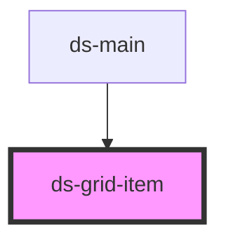

# ds-grid-item

<!-- Auto Generated Below -->

## Properties

| Property         | Attribute | Description | Type               | Default     |
| ---------------- | --------- | ----------- | ------------------ | ----------- |
| `ratioFromProps` | `ratio`   |             | `number \| string` | `undefined` |
| `width`          | `width`   |             | `number`           | `1`         |

## Methods

### `getWidth() => Promise<number>`

#### Returns

Type: `Promise<number>`

### `setStyles(styles: DSGridItemStyles) => Promise<void>`

#### Parameters

| Name     | Type               | Description |
| -------- | ------------------ | ----------- |
| `styles` | `DSGridItemStyles` |             |

#### Returns

Type: `Promise<void>`

## Dependencies

### Used by

 - [ds-main](../../..)

### Graph

----------------------------------------------

*Built with [StencilJS](https://stenciljs.com/)*
