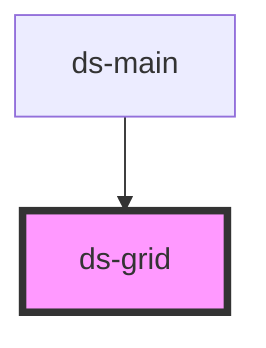

# ds-grid

<!-- Auto Generated Below -->

## Properties

| Property     | Attribute      | Description | Type                 | Default     |
| ------------ | -------------- | ----------- | -------------------- | ----------- |
| `align`      | `align`        |             | `string`             | `"start"`   |
| `cellRatio`  | `cell-ratio`   |             | `number \| string`   | `undefined` |
| `cols`       | `cols`         |             | `number \| string`   | `1`         |
| `dataUseRsp` | `data-use-rsp` |             | `boolean`            | `true`      |
| `hGap`       | `h-gap`        |             | `string`             | `'0'`       |
| `mods`       | `mods`         |             | `string \| string[]` | `[]`        |
| `type`       | `type`         |             | `string`             | `'fixed'`   |
| `vAlign`     | `v-align`      |             | `string`             | `"start"`   |
| `vGap`       | `v-gap`        |             | `string`             | `'0'`       |

## Dependencies

### Used by

 - [ds-main](../..)

### Graph

----------------------------------------------

*Built with [StencilJS](https://stenciljs.com/)*
