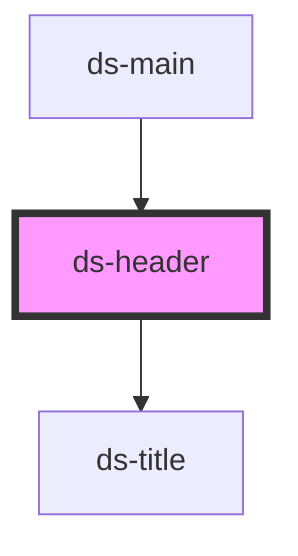

# ds-header

<!-- Auto Generated Below -->

## Properties

| Property | Attribute | Description | Type                 | Default |
| -------- | --------- | ----------- | -------------------- | ------- |
| `mods`   | `mods`    |             | `string \| string[]` | `[]`    |

## Dependencies

### Used by

 - [ds-main](../..)

### Depends on

- [ds-title](../title)

### Graph

----------------------------------------------

*Built with [StencilJS](https://stenciljs.com/)*
