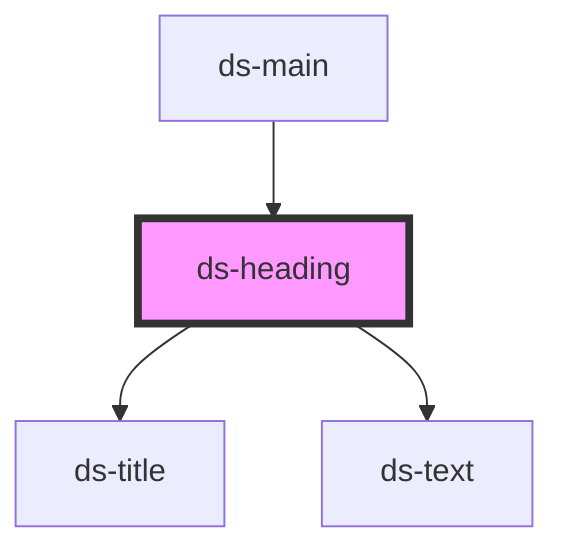

# ds-heading

<!-- Auto Generated Below -->

## Properties

| Property        | Attribute        | Description                                                                                        | Type                 | Default          |
| --------------- | ---------------- | -------------------------------------------------------------------------------------------------- | -------------------- | ---------------- |
| `block`         | `block`          |                                                                                                    | `boolean`            | `undefined`      |
| `imagePosition` | `image-position` |                                                                                                    | `string`             | `'block-before'` |
| `mods`          | `mods`           | Comma-separated list (or array) of modifiers, rendered as `--<modifier>` classes on the component. | `string \| string[]` | `[]`             |
| `section`       | `section`        |                                                                                                    | `boolean`            | `undefined`      |
| `useContext`    | `use-context`    |                                                                                                    | `boolean`            | `undefined`      |

## Dependencies

### Used by

 - [ds-main](../../demo)

### Depends on

- [ds-title](../title)
- [ds-text](../text)

### Graph

----------------------------------------------

*Built with [StencilJS](https://stenciljs.com/)*
