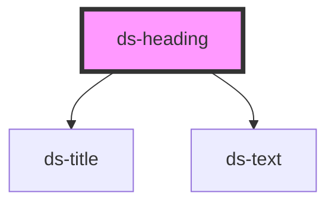

# ds-heading

## Styling

- **Classes**: `ds-heading` on `<ds-heading>`, and `--<image-position>` (`--block-before` by default).
- **Elements**: `__image` (slot `image`), `__content` (an `hgroup`), `__main-title` (a `ds-title`, the default slot), `__sub-title` (a `ds-title` with `sub`, slot `sub-title`) and `__description` (a `ds-text`, slot `description`). The image, sub-title and description are rendered when their slot has content.
- **Modifiers**: `mods` → `--<mod>`.
- **Attributes**: `section` and `block` (reflected, passed on to the titles: their size), `image-position`, `mods`. The default theme centers a `section` heading.
- **Structure** (`heading.scss`): a block element; an empty wrapper is hidden.
- **Look** (default theme, `components/_heading.scss`): the spacing of the parts, a fluid image, and the color and width of the description, from the custom properties below, set on `ds-heading`. The titles are `ds-title` elements: their colors and font are the `--ds-title-*` properties, set on `ds-title`.

Override them after the theme stylesheet (see [Styling a component](../../../README.md#styling-a-component)):

```css
ds-heading {
  --ds-heading-gap: 3rem;
  --ds-heading-description-color: var(--ds-color-gray-dark);
}

/* The titles of the headings only */
ds-heading ds-title {
  --ds-title-color: var(--ds-color-primary-darker);
}
```

<!-- Auto Generated Below -->


## Properties

| Property        | Attribute        | Description                                                                                        | Type                 | Default          |
| --------------- | ---------------- | -------------------------------------------------------------------------------------------------- | -------------------- | ---------------- |
| `block`         | `block`          |                                                                                                    | `boolean`            | `undefined`      |
| `imagePosition` | `image-position` |                                                                                                    | `string`             | `'block-before'` |
| `mods`          | `mods`           | Comma-separated list (or array) of modifiers, rendered as `--<modifier>` classes on the component. | `string \| string[]` | `[]`             |
| `section`       | `section`        |                                                                                                    | `boolean`            | `undefined`      |
| `useContext`    | `use-context`    |                                                                                                    | `boolean`            | `undefined`      |


## CSS Custom Properties

| Name                                 | Description                                                         |
| ------------------------------------ | ------------------------------------------------------------------- |
| `--ds-heading-description-color`     | Text color of the description (`__description`).                    |
| `--ds-heading-description-max-width` | Maximum width of the description (centered in a `section` heading). |
| `--ds-heading-gap`                   | Space below the heading.                                            |
| `--ds-heading-image-gap`             | Space between the image (`__image`) and the titles.                 |


## Dependencies

### Depends on

- [ds-title](../title)
- [ds-text](../text)

### Graph


----------------------------------------------

*Built with [StencilJS](https://stenciljs.com/)*
