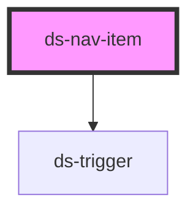

# ds-nav-menu-item

## Styling

- **Classes**: `<ds-nav-item>` renders a `div` with the main class, `ds-nav-item`, and `--with-children` (`has-children`), `--active` (`is-active`), `--open` (its sub-navigation was opened by its expand button), `--depth-<depth>` and `--<type>-<item-id>` (`--page-home`).
- **Elements**: `__link` (the default slot: the link), and with `has-children`, `__expand-button` (a `ds-trigger` with the `ds-button --menu-item` classes) and `__sub-nav` (slot `children`: a `ds-nav`).
- **Attributes** (reflected): `type`, `depth`, `has-children`, `is-active`, `is-animated`.
- **Structure** (`nav-item.scss`): the item is the containing block of its expand button and sub-navigation. How the sub-navigation opens depends on the breakpoints, which the component stylesheets cannot read: the theme writes it (`components/_nav.scss`, to copy into a new theme). Below `md`, the sub-navigation is collapsed (`height: 0`, `overflow: hidden`) and the expand button opens it: `ds-nav-item` animates its height, and waits for the end of a `height` transition to set it to `auto`. From `md`, the expand button is hidden and the sub-navigation drops down on hover or focus (to the right for a nested one).
- **Look** (default theme, `components/_nav.scss`): the links, the lines between the items and the drop-down sub-navigations, from the custom properties below, set on every `ds-nav-item` (a nested item does not inherit them from its parent). The expand button is the `--menu-item` button skin: a plus, a minus once open.

Override them after the theme stylesheet (see [Styling a component](../../../../README.md#styling-a-component)):

```css
ds-nav-item {
  --ds-nav-item-active-color: var(--ds-color-secondary-base);
}

.ds-footer ds-nav-item {
  --ds-nav-item-color: var(--ds-color-gray-white);
}
```

<!-- Auto Generated Below -->


## Properties

| Property      | Attribute      | Description | Type      | Default     |
| ------------- | -------------- | ----------- | --------- | ----------- |
| `depth`       | `depth`        |             | `number`  | `0`         |
| `hasChildren` | `has-children` |             | `boolean` | `false`     |
| `isActive`    | `is-active`    |             | `boolean` | `false`     |
| `isAnimated`  | `is-animated`  |             | `boolean` | `true`      |
| `itemId`      | `item-id`      |             | `string`  | `undefined` |
| `type`        | `type`         |             | `string`  | `'page'`    |


## Events

| Event             | Description | Type               |
| ----------------- | ----------- | ------------------ |
| `dsMenuItemClick` |             | `CustomEvent<any>` |


## Slots

| Slot         | Description      |
| ------------ | ---------------- |
|              | The default slot |
| `"children"` |                  |


## CSS Custom Properties

| Name                               | Description                                                                                                 |
| ---------------------------------- | ----------------------------------------------------------------------------------------------------------- |
| `--ds-nav-item-active-color`       | Text color of the link of an active item (`--active`), and of a hovered link.                               |
| `--ds-nav-item-border-color`       | Color of the line under each item (below `md`) and of the border of a drop-down sub-navigation (from `md`). |
| `--ds-nav-item-color`              | Text color of the link.                                                                                     |
| `--ds-nav-item-padding`            | Padding of the link (from `md`, the links of a drop-down sub-navigation have their own).                    |
| `--ds-nav-item-sub-nav-background` | Background of a drop-down sub-navigation (from `md`).                                                       |
| `--ds-nav-item-sub-nav-shadow`     | Shadow of a drop-down sub-navigation (from `md`).                                                           |


## Dependencies

### Depends on

- [ds-trigger](../../trigger)

### Graph


----------------------------------------------

*Built with [StencilJS](https://stenciljs.com/)*
