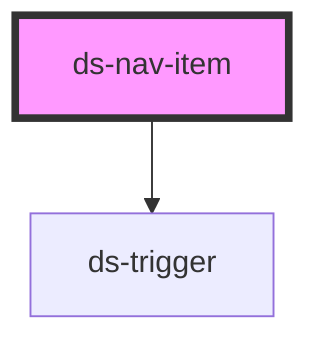

# ds-nav-item

## Styling

- **Classes**: `<ds-nav-item>` renders a `div` with the main class, `ds-nav-item`, and `--with-children` (`has-children`), `--active` (`is-active`, or its sub-navigation is open), `--open` (its sub-navigation was opened by its expand button), `--dismissed` (its drop-down sub-navigation was hidden by Escape), `--depth-<depth>` and `--<type>-<item-id>` (`--page-home`).
- **Elements**: `__link` (the default slot: the link), and with `has-children`, `__expand-button` (a `ds-trigger` with the `ds-button --menu-item` classes) and `__sub-nav` (slot `children`: a `ds-nav`).
- **Attributes** (reflected): `type`, `depth`, `has-children`, `is-active`, `is-animated`. The component sets `role="listitem"` on `<ds-nav-item>` in a `ds-nav`, `aria-current` on its link, and the name and ARIA attributes of its expand button (see [Accessibility](#accessibility)).
- **Structure** (`nav-item.scss`): the item is the containing block of its expand button and sub-navigation. How the sub-navigation opens depends on the breakpoints, which the component stylesheets cannot read: the theme writes it (`components/_nav.scss`, to copy into a new theme). Below `md`, the sub-navigation is collapsed (`height: 0`, `overflow: hidden`) and hidden once it has collapsed (`visibility: hidden`, after its height transition: out of the Tab order and of the accessibility tree); the expand button opens it (`--open`: visible at once). `ds-nav-item` animates its height and sets it to `auto` at the end of the `height` transition (at once without one, or once its duration is over without `transitionend`); with `is-animated="false"`, the theme opens it at once (`height: auto`). From `md`, the expand button is hidden and the sub-navigation drops down on hover or focus (to the right for a nested one), but with `--dismissed`.
- **Look** (default theme, `components/_nav.scss`): the links, the lines between the items and the drop-down sub-navigations, from the custom properties below, set on every `ds-nav-item` (a nested item does not inherit them from its parent). The expand button is the `--menu-item` button skin: a plus, a minus once open; the focus indicator of the theme draws around it.

Override them after the theme stylesheet (see [Styling a component](../../../../README.md#styling-a-component)):

```css
ds-nav-item {
  --ds-nav-item-active-color: var(--ds-color-secondary-base);
}

.ds-footer ds-nav-item {
  --ds-nav-item-color: var(--ds-color-gray-white);
}
```

## Accessibility

An item with a sub-navigation follows the WAI-ARIA [disclosure navigation pattern, with top-level links](https://www.w3.org/WAI/ARIA/apg/patterns/disclosure/examples/disclosure-navigation-hybrid/): its link goes to its page, its expand button shows and hides the sub-navigation. It is not a menu (no `menu` or `menuitem` role, no arrow keys): the links are reached with Tab.

- **List item**: in a `ds-nav`, the element is a `listitem` of its list.
- **Current page**: `is-active` marks the item of the current page: its link (the first `a[href]` of the default slot) gets `aria-current="page"`, unless it has an `aria-current` of its own (`location`, `true` for a section…). The expand button no longer changes `is-active` (an open item is `--active` for the look only).
- **Expand button**: a `ds-trigger` button (`role="button"`, in the Tab order, Enter and Space) with `aria-expanded` and `aria-controls` (the id of `__sub-nav`), named by `toggle-label`, `{label} submenu` by default ("About submenu"): `{label}` is `label`, else the text of the link.
- **Collapsed sub-navigation** (the theme below `md`): hidden once it has collapsed (`visibility: hidden`): its links are out of the Tab order and of the accessibility tree.
- **Drop-down sub-navigation** (the theme from `md`): the expand button is hidden; the sub-navigation shows on hover and when the focus is in the item (its links are in the Tab order after the link of the item).
- **Keyboard**:

  | Key          | Action                                                                                                                                                                                                                                        |
  | ------------ | --------------------------------------------------------------------------------------------------------------------------------------------------------------------------------------------------------------------------------------------- |
  | Tab          | Moves to the next link or button (a collapsed sub-navigation is skipped)                                                                                                                                                                      |
  | Enter, Space | On the expand button: opens or closes the sub-navigation                                                                                                                                                                                      |
  | Escape       | In the item (its link, its button or its sub-navigation): closes the open sub-navigation and moves the focus to its expand button (the innermost one first); a drop-down sub-navigation is hidden and the focus moves to the link of the item |

  A drop-down sub-navigation hidden by Escape shows again when the focus moves into it, or once the focus and the pointer have left the item; under the pointer, with the focus elsewhere, Escape hides it too (the content shown on hover can be dismissed without moving the pointer). Escape goes on to the parent item when there is nothing to close, and stops once it has closed one.

- **Events**: `dsMenuItemClick` (`{ isSelected }`: the new state of the sub-navigation) when the expand button or Escape opens or closes it.

```html
<ds-nav-item has-children toggle-label="Sous-menu {label}"
  ><a href="/about">About</a>
  <ds-nav slot="children">…</ds-nav>
</ds-nav-item>
```

**Changed**: the list item role, `aria-current`, the name, `aria-expanded` and `aria-controls` of the expand button, Escape, `label`, `toggle-label` and the `--dismissed` class are new; the expand button opens and closes the sub-navigation without changing `is-active` (which marks the current page), and an open item still has the `--active` class; the collapsed sub-navigation is hidden (its links could be reached with Tab); the height transition ends with `waitForTransition` (it waited for `transitionend` only).

<!-- Auto Generated Below -->


## Overview

An item of a `ds-nav`: a link (the default slot) and, with `has-children`, a sub-navigation (slot `children`, a
`ds-nav`) and its expand button. It follows the WAI-ARIA disclosure navigation pattern (not a menu): the expand button
(`aria-expanded`, `aria-controls`) shows and hides the sub-navigation, which is hidden from the keyboard and from
assistive technologies while it is collapsed (the theme: `visibility: hidden` once it has collapsed); Escape closes the
sub-navigation that has the focus and gives the focus back to its button. Where the theme drops the sub-navigation
down on hover and focus instead (from `md`: no expand button), Escape hides it until the focus or the pointer leaves
the item. `is-active` marks the current page: its link gets `aria-current="page"`.

## Properties

| Property      | Attribute      | Description                                                                                                     | Type      | Default             |
| ------------- | -------------- | --------------------------------------------------------------------------------------------------------------- | --------- | ------------------- |
| `depth`       | `depth`        |                                                                                                                 | `number`  | `0`                 |
| `hasChildren` | `has-children` |                                                                                                                 | `boolean` | `false`             |
| `isActive`    | `is-active`    | The item of the current page: its link gets `aria-current="page"` (unless it has an `aria-current` of its own). | `boolean` | `false`             |
| `isAnimated`  | `is-animated`  | Whether the expand button animates the height of the sub-navigation (`false`: the theme opens it, on `--open`). | `boolean` | `true`              |
| `itemId`      | `item-id`      |                                                                                                                 | `string`  | `undefined`         |
| `label`       | `label`        | The name of the item in the name of its expand button. Default: the text of its link.                           | `string`  | `undefined`         |
| `toggleLabel` | `toggle-label` | The name of the expand button (`aria-label`): `{label}` is the name of the item.                                | `string`  | `'{label} submenu'` |
| `type`        | `type`         |                                                                                                                 | `string`  | `'page'`            |


## Events

| Event             | Description | Type               |
| ----------------- | ----------- | ------------------ |
| `dsMenuItemClick` |             | `CustomEvent<any>` |


## Slots

| Slot         | Description                                               |
| ------------ | --------------------------------------------------------- |
|              | The link of the item.                                     |
| `"children"` | The sub-navigation: a `ds-nav` of `ds-nav-item` elements. |


## CSS Custom Properties

| Name                               | Description                                                                                                 |
| ---------------------------------- | ----------------------------------------------------------------------------------------------------------- |
| `--ds-nav-item-active-color`       | Text color of the link of an active item (`--active`), and of a hovered link.                               |
| `--ds-nav-item-border-color`       | Color of the line under each item (below `md`) and of the border of a drop-down sub-navigation (from `md`). |
| `--ds-nav-item-color`              | Text color of the link.                                                                                     |
| `--ds-nav-item-padding`            | Padding of the link (from `md`, the links of a drop-down sub-navigation have their own).                    |
| `--ds-nav-item-sub-nav-background` | Background of a drop-down sub-navigation (from `md`).                                                       |
| `--ds-nav-item-sub-nav-shadow`     | Shadow of a drop-down sub-navigation (from `md`).                                                           |


## Dependencies

### Depends on

- [ds-trigger](../../trigger)

### Graph


----------------------------------------------

*Built with [StencilJS](https://stenciljs.com/)*
