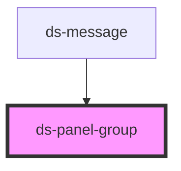

# ds-panel-group

<!-- Auto Generated Below -->

## Properties

| Property      | Attribute      | Description | Type                     | Default |
| ------------- | -------------- | ----------- | ------------------------ | ------- |
| `isActive`    | `active`       |             | `boolean`                | `true`  |
| `mods`        | `mods`         |             | `string \| string[]`     | `[]`    |
| `soloContent` | `solo-content` |             | `boolean`                | `false` |
| `type`        | `type`         |             | `"collapsible" \| "tab"` | `"tab"` |

## Methods

### `getItems() => Promise<HTMLDsPanelElement[]>`

#### Returns

Type: `Promise<HTMLDsPanelElement[]>`

### `hidePanel(index?: number) => Promise<void>`

#### Parameters

| Name    | Type     | Description |
| ------- | -------- | ----------- |
| `index` | `number` |             |

#### Returns

Type: `Promise<void>`

### `showPanel(index: number) => Promise<void>`

#### Parameters

| Name    | Type     | Description |
| ------- | -------- | ----------- |
| `index` | `number` |             |

#### Returns

Type: `Promise<void>`

## Dependencies

### Used by

 - [ds-message](../message)

### Graph

----------------------------------------------

*Built with [StencilJS](https://stenciljs.com/)*
