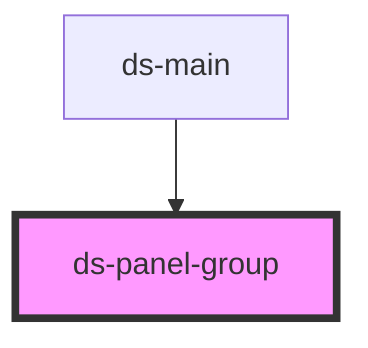

# ds-toggler

<!-- Auto Generated Below -->

## Properties

| Property   | Attribute | Description | Type                 | Default |
| ---------- | --------- | ----------- | -------------------- | ------- |
| `isActive` | `active`  |             | `boolean`            | `true`  |
| `mods`     | `mods`    |             | `string \| string[]` | `[]`    |

## Dependencies

### Used by

 - [ds-main](../..)

### Graph

----------------------------------------------

*Built with [StencilJS](https://stenciljs.com/)*
