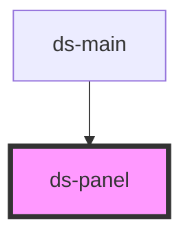

# ds-panel

<!-- Auto Generated Below -->

## Properties

| Property    | Attribute    | Description | Type                     | Default     |
| ----------- | ------------ | ----------- | ------------------------ | ----------- |
| `expanded`  | `expanded`   |             | `boolean`                | `false`     |
| `index`     | `index`      |             | `number`                 | `undefined` |
| `minHeight` | `min-height` |             | `string`                 | `"0"`       |
| `mods`      | `mods`       |             | `string \| string[]`     | `[]`        |
| `type`      | `type`       |             | `"collapsible" \| "tab"` | `"tab"`     |

## Events

| Event         | Description | Type               |
| ------------- | ----------- | ------------------ |
| `panelHidden` |             | `CustomEvent<any>` |
| `panelHide`   |             | `CustomEvent<any>` |
| `panelShow`   |             | `CustomEvent<any>` |
| `panelShown`  |             | `CustomEvent<any>` |

## Methods

### `hide() => Promise<void>`

#### Returns

Type: `Promise<void>`

### `setIndex(index: number) => Promise<void>`

#### Parameters

| Name    | Type     | Description |
| ------- | -------- | ----------- |
| `index` | `number` |             |

#### Returns

Type: `Promise<void>`

### `setType(type: PanelType) => Promise<void>`

#### Parameters

| Name   | Type                     | Description |
| ------ | ------------------------ | ----------- |
| `type` | `"tab" \| "collapsible"` |             |

#### Returns

Type: `Promise<void>`

### `show() => Promise<void>`

#### Returns

Type: `Promise<void>`

### `toggle(mustShow?: boolean) => Promise<void>`

#### Parameters

| Name       | Type      | Description |
| ---------- | --------- | ----------- |
| `mustShow` | `boolean` |             |

#### Returns

Type: `Promise<void>`

## Dependencies

### Used by

 - [ds-main](../../demo)

### Graph

----------------------------------------------

*Built with [StencilJS](https://stenciljs.com/)*
