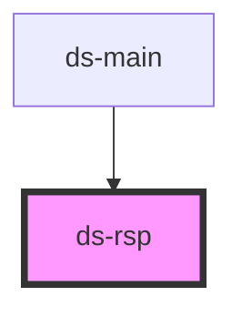

# ds-rsp

<!-- Auto Generated Below -->

## Properties

| Property              | Attribute             | Description | Type                       | Default                                 |
| --------------------- | --------------------- | ----------- | -------------------------- | --------------------------------------- |
| `breakpointsFromProp` | --                    |             | `{ [x: string]: number; }` | `undefined`                             |
| `debounceDelay`       | `debounce-delay`      |             | `number`                   | `500`                                   |
| `propertyName`        | `property-name`       |             | `string`                   | `'data-rsp'`                            |
| `subscriberSelector`  | `subscriber-selector` |             | `string`                   | `'[data-use-rsp]:not([data-rsp-init])'` |

## Events

| Event              | Description | Type               |
| ------------------ | ----------- | ------------------ |
| `breakpointChange` |             | `CustomEvent<any>` |

## Methods

### `getBreakpoint(rawBreakpoints: { [label: string]: number[]; }) => Promise<Breakpoint>`

Get the current breakpoint

#### Parameters

| Name             | Type                             | Description                             |
| ---------------- | -------------------------------- | --------------------------------------- |
| `rawBreakpoints` | `{ [label: string]: number[]; }` | JSON Object containings all breakpoints |

#### Returns

Type: `Promise<Breakpoint>`

current breakpoint ( label & limits )

### `getBreakpoints() => Promise<Breakpoints>`

#### Returns

Type: `Promise<Breakpoints>`

### `getCurrentBreakpoint() => Promise<Breakpoint>`

#### Returns

Type: `Promise<Breakpoint>`

### `getData() => Promise<{ breakpoints: Breakpoints; }>`

#### Returns

Type: `Promise<{ breakpoints: Breakpoints; }>`

### `getParamsForBreakpoint(currentBreakpoint: Breakpoint, params: { [breakpointLabel: string]: Record<string, unknown>; }) => Promise<Record<string, unknown>>`

#### Parameters

| Name                | Type                                                      | Description |
| ------------------- | --------------------------------------------------------- | ----------- |
| `currentBreakpoint` | `Breakpoint`                                              |             |
| `params`            | `{ [breakpointLabel: string]: Record<string, unknown>; }` |             |

#### Returns

Type: `Promise<Record<string, unknown>>`

### `getSubscribers() => Promise<Element[]>`

#### Returns

Type: `Promise<Element[]>`

### `processBreakpoints(breakpoints: RawBreakpoint) => Promise<Breakpoints>`

#### Parameters

| Name          | Type            | Description |
| ------------- | --------------- | ----------- |
| `breakpoints` | `RawBreakpoint` |             |

#### Returns

Type: `Promise<Breakpoints>`

### `subscribe(target: Element) => Promise<number>`

#### Parameters

| Name     | Type      | Description |
| -------- | --------- | ----------- |
| `target` | `Element` |             |

#### Returns

Type: `Promise<number>`

## Dependencies

### Used by

 - [ds-main](../../demo)

### Graph

----------------------------------------------

*Built with [StencilJS](https://stenciljs.com/)*
