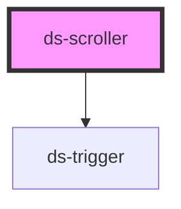

# ds-scroller

A row of items that scrolls, with the native scrolling of the browser: a row of tiles, of posters, of cards. The item that takes the focus is kept in view, and no item is ever hidden from the keyboard or from assistive technologies.

```html
<ds-scroller label="Continue watching" controls>
  <a href="/movies/matrix" class="tile">…</a>
  <a href="/movies/heat" class="tile">…</a>
  …
</ds-scroller>
```

## Scrolling

- **Native**: the viewport (`__viewport`) scrolls as any scrolling box: the wheel, a swipe, the scrollbar, the keys of the browser. Its items are its direct children, side by side (`orientation="vertical"`: one under the other; give the scroller a height, or put it in an element of a fixed height).
- **The focus**: when an element of an item takes the focus (Tab, a click, `focus()` from a script or from the spatial navigation of a game pad), the scroller shows that item whole (the element alone when the item is larger than the view), scrolling as little as it can: to the nearest edge, at `--ds-scroller-focus-margin` from it (24 px in the `default` theme). The browser scrolls a focused element to the center of the view before the scroller hears of it: the scroller counts the distance from where it was before, and moves from there, smoothly (at once with less motion). A quick run of focus moves (a key held down) goes on from where the last scroll was going.
- **Snap** (`snap`): the scroll stops on the start of an item (`scroll-snap-type: mandatory`, `scroll-snap-align: start`), at the margin.
- **Never inert**: unlike `ds-slider`, the items out of view are neither inert nor hidden: they stay in the Tab order and in the accessibility tree, and a navigation that looks for the focusable elements of the page finds them all. The scroller follows the focus wherever it goes.
- **Controls** (`controls`): a previous and a next button (`ds-trigger`), over the sides, which scroll by a page: the width of the view less its margins (the height, `vertical`). Each one is rendered only while there is something to scroll to on its side: none while the content fits, the next one alone at the start, the previous one alone at the end. A button that disappears while it has the focus gives it to the other one. `next()` and `previous()` do the same from a script.
- **State**: `--overflowing` while the content is larger than the view, `--at-start` and `--at-end` at the ends; the scroller measures again when the view or an item changes size (an image that loads) and when an item is added or removed, and on `refresh()`.

## Styling

- **Classes**: `ds-scroller` on `<ds-scroller>`; `--horizontal` or `--vertical` (`orientation`), `--snap` (`snap`), `--controls` (`controls`, while the content overflows), `--overflowing`, `--at-start`, `--at-end`; `mods` → `--<mod>`.
- **Elements**: `__viewport` (the scrolling box, which holds the items), `__prev` and `__next` (the buttons: `ds-trigger type="button"`, with the `.ds-button.--scroller.--prev` and `.--next` classes).
- **Attributes** (reflected): `orientation`, `snap`, `controls`, `mods`; with `label`, `role="region"` and `aria-label`.
- **Structure** (`scroller.scss`): the viewport is a flex row (a column, `--vertical`) that scrolls on its axis, its items at their own size (`flex: 0 0 auto`: give them a width), `--ds-scroller-gap` apart, with its padding inside it (`--ds-scroller-padding`: the focus outline of an item at its edges shows) and its scroll padding (`--ds-scroller-focus-margin`), which the snap positions and the scroll to a focused item keep. A scroll that reaches its end does not scroll the page (`overscroll-behavior: contain`). The buttons are over the sides (`--ds-scroller-button-offset` from them, the previous one on the start side: the right, from right to left), centered on the height (on the width, `--vertical`).
- **Look** (default theme, `components/_scroller.scss`): a gap of 1rem, a padding of 0.25rem, a margin of 1.5rem, a thin scrollbar; the buttons round, white with a light gray border, a chevron in them (mirrored from right to left; up and down, `--vertical`).

Override them after the theme stylesheet (see [Styling a component](../../../README.md#styling-a-component)):

```css
ds-scroller {
  --ds-scroller-gap: var(--ds-space-2);
  --ds-scroller-focus-margin: 4rem;
}

/* No scrollbar, for a row a remote control or a game pad drives */
.home ds-scroller .ds-scroller__viewport {
  scrollbar-width: none;
}
```

## Accessibility

- **Role**: none by default (a group of items of the page, read in their order); with `label`, a `region` named by it ("Continue watching", "Recently added"), a landmark: give a label to the rows that matter, not to each of them (a page of twenty regions is a long list of landmarks). The items keep their own semantics: write them as a list when they are one (`<ds-scroller><ul>` is not laid out: put the `role="list"` on the scroller and `role="listitem"` on the items, or a heading before each row).
- **Keyboard**: Tab reaches every item, in the order of the page, in view or not (none is inert); the scroller brings it into view. The arrow keys scroll the view when it has the focus or when an element of it that does not use them has it (the browser's). Each item that should be reached is focusable (a link, a button): a row of images without a control is scrolled with the wheel, a swipe, the scrollbar, or the buttons.
- **The buttons** (`controls`): native buttons of `ds-trigger` (`role="button"`, Enter and Space), named by `labels` ("Previous items", "Next items"), in the Tab order: the previous one before the items, the next one after them. They are a help for the pointer: the keyboard reaches the items without them.
- **Focus**: never moved by the scroller, but from a button that disappears to the other one. The focus outline of an item at the edges of the view shows (the padding of the viewport).
- **Motion**: the scroll to a focused item and by a page is smooth, at once with less motion (`prefers-reduced-motion: reduce`).

## Texts

`labels` (JSON as an attribute) translates the names of the buttons:

| Key        | Default          | What it is                                       |
| ---------- | ---------------- | ------------------------------------------------ |
| `previous` | `Previous items` | The name of the button that scrolls back.        |
| `next`     | `Next items`     | The name of the button that scrolls forward.     |

```html
<ds-scroller label="Reprendre" controls labels='{"previous": "Éléments précédents", "next": "Éléments suivants"}'>…</ds-scroller>
```

## Examples

```html
<!-- A row of posters that stops on each one -->
<h2>Recently added</h2>
<ds-scroller snap>
  <a href="/movies/1"><ds-thumb src="/p/1.jpg" alt="Heat" ratio="2/3" style="width: 10rem"></ds-thumb></a>
  <a href="/movies/2"><ds-thumb src="/p/2.jpg" alt="Ronin" ratio="2/3" style="width: 10rem"></ds-thumb></a>
</ds-scroller>

<!-- A column, in a sidebar 30rem high -->
<div style="height: 30rem">
  <ds-scroller orientation="vertical" label="Channels">…</ds-scroller>
</div>
```

## Limits

- One row (or column): the items do not wrap.
- A region is named by `label` only (not by `aria-labelledby`).
- The page of `next()` is the width of the view, less the margins; with `snap`, the browser then stops on the start of an item.
- Tested in Chromium only: the scroll of a focused element to the center of the view is that of Chromium; another browser that scrolls to the nearest edge, or not at all, gives the same result.

**New**: `ds-scroller` is new.

<!-- Auto Generated Below -->


## Overview

A row of items that scrolls, with the native scrolling of the browser (the wheel, a swipe, the scrollbar, the keys of
a focused scroller): horizontal by default, or `vertical`. It keeps the element that takes the focus in it in view,
scrolling as little as it can (to the nearest edge, not to the center), with a margin from the edges: the
`scroll-padding` of the viewport, `--ds-scroller-focus-margin`. With `snap`, it stops on the start of an item
(`scroll-snap-type`).

Unlike `ds-slider`, it never makes the items out of view inert nor hidden: they stay in the Tab order and in the
accessibility tree, so that the focus can reach every item (a spatial navigation of the page, with a game pad,
finds them) and the scroller follows it.

With `controls`, a previous and a next button (`ds-trigger`, named by `labels`) scroll by a page; each one is hidden at
its end. Its classes tell whether its content overflows (`--overflowing`) and whether it is at its start or its end
(`--at-start`, `--at-end`). A `label` makes it a region of the page, with that name.

## Properties

| Property      | Attribute     | Description                                                                                                           | Type                         | Default        |
| ------------- | ------------- | --------------------------------------------------------------------------------------------------------------------- | ---------------------------- | -------------- |
| `controls`    | `controls`    | Renders a previous and a next button, which scroll by a page, each one hidden at its end.                             | `boolean`                    | `false`        |
| `label`       | `label`       | The name of the scroller (`aria-label`): with it, the scroller is a region of the page (`role="region"`), a landmark. | `string`                     | `undefined`    |
| `labels`      | `labels`      | The texts of the scroller (JSON as an attribute), to translate them: `previous`, `next` (the names of the buttons).   | `DSScrollerLabels \| string` | `{}`           |
| `mods`        | `mods`        | Comma-separated list (or array) of modifiers, rendered as `--<modifier>` classes on the component.                    | `string \| string[]`         | `[]`           |
| `orientation` | `orientation` | The direction it scrolls in: `horizontal` (a row, by default) or `vertical` (a column; give the scroller a height).   | `"horizontal" \| "vertical"` | `'horizontal'` |
| `snap`        | `snap`        | Stops the scroll on the start of an item (`scroll-snap-type: mandatory`, `scroll-snap-align: start`).                 | `boolean`                    | `false`        |


## Methods

### `next() => Promise<void>`

Scrolls forward by a page: the width of the viewport less its margins (its height, `vertical`).

#### Returns

Type: `Promise<void>`


### `previous() => Promise<void>`

Scrolls back by a page.

#### Returns

Type: `Promise<void>`


### `refresh() => Promise<void>`

Measures the content again: whether it overflows, and is at its start or its end (after a change no observer saw).

#### Returns

Type: `Promise<void>`


## Slots

| Slot | Description                                                                      |
| ---- | -------------------------------------------------------------------------------- |
|      | The items: the direct children of the scroller, laid out in a row (or a column). |


## CSS Custom Properties

| Name                                | Description                                                                                           |
| ----------------------------------- | ----------------------------------------------------------------------------------------------------- |
| `--ds-scroller-button-background`   | Background of the previous / next buttons.                                                            |
| `--ds-scroller-button-border-color` | Border color of the previous / next buttons.                                                          |
| `--ds-scroller-button-offset`       | Distance between the previous / next buttons and the sides of the scroller.                           |
| `--ds-scroller-button-size`         | Width and height of the previous / next buttons.                                                      |
| `--ds-scroller-focus-margin`        | Space kept between an item that takes the focus and the edges of the viewport (its `scroll-padding`). |
| `--ds-scroller-gap`                 | Space between the items.                                                                              |
| `--ds-scroller-padding`             | Padding inside the viewport, around the items: room for their focus outline.                          |


## Dependencies

### Depends on

- [ds-trigger](../trigger)

### Graph


----------------------------------------------

*Built with [StencilJS](https://stenciljs.com/)*
