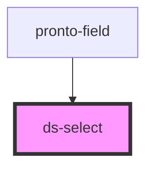

# ds-select

<!-- Auto Generated Below -->

## Properties

| Property       | Attribute       | Description | Type                 | Default     |
| -------------- | --------------- | ----------- | -------------------- | ----------- |
| `defaultValue` | `default-value` |             | `string`             | `undefined` |
| `disabled`     | `disabled`      |             | `boolean`            | `undefined` |
| `mods`         | `mods`          |             | `string \| string[]` | `[]`        |
| `name`         | `name`          |             | `string`             | `undefined` |

## Events

| Event         | Description | Type               |
| ------------- | ----------- | ------------------ |
| `valueChange` |             | `CustomEvent<any>` |

## Methods

### `getValue() => Promise<{ value: string; label: string; }>`

#### Returns

Type: `Promise<{ value: string; label: string; }>`

## Dependencies

### Used by

 - [pronto-field](../../pronto/pronto-content/form)

### Graph

----------------------------------------------

*Built with [StencilJS](https://stenciljs.com/)*
