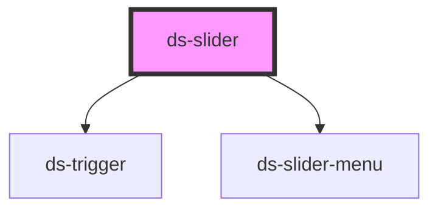

# ds-slider

## Styling

- **Classes**: `<ds-slider>` renders a `div` with the main class, `ds-slider`, its modifiers, and the state classes: `--hrt` or `--vtc` (`params.orientation`), `--playing` or `--paused`, `--scrollable` (the items overflow), `--draggable`, `--isReady` (measured), `--transition` (while it slides).
- **Elements**: `__container` (clips the list), `__list` (the default slot, the `ds-slider-item` elements; `--sliding` while it slides, and the class of its orientation, `hrt` or `vtc`), `__prev-button` and `__next-button` (`ds-trigger` elements with the `ds-button --slider --prev` / `--next` classes, rendered when the items overflow and `params.controls` is set), and a `ds-slider-menu` with `params.menu`.
- **Attributes** (reflected): `slider-id`, `params`, `type`, `mods`.
- **Structure** (`slider.scss`): the items are a flex row (a column with `--vtc`) in the container, which clips it; the slider measures them and writes the sizes and the transform of a slide as inline styles. A slide is a `transform` transition of `--ds-slider-transition-duration` on the list: the slider ends it on its `transitionend` event, so keep it above 0. The buttons are over the sides of the slider, vertically centered, `--ds-slider-button-offset` from the edges.
- **Look** (default theme, `components/_slider.scss`): round previous / next buttons with a chevron, from the custom properties below, set on `ds-slider`. The other colors of the buttons come from the button skin (`ds-trigger`). The dots of the menu: see `ds-slider-menu`.

Override them after the theme stylesheet (see [Styling a component](../../../README.md#styling-a-component)):

```css
ds-slider {
  --ds-slider-button-size: 2.5rem;
  --ds-slider-button-offset: 0;
}
```

<!-- Auto Generated Below -->


## Properties

| Property   | Attribute   | Description                                                                                        | Type                       | Default                     |
| ---------- | ----------- | -------------------------------------------------------------------------------------------------- | -------------------------- | --------------------------- |
| `mods`     | `mods`      | Comma-separated list (or array) of modifiers, rendered as `--<modifier>` classes on the component. | `string \| string[]`       | `[]`                        |
| `params`   | `params`    |                                                                                                    | `DSSliderParams \| string` | `{}`                        |
| `sliderId` | `slider-id` |                                                                                                    | `string`                   | `` `slide-${sliderId++}` `` |
| `type`     | `type`      |                                                                                                    | `string`                   | `'sld'`                     |


## Events

| Event         | Description | Type                                                                        |
| ------------- | ----------- | --------------------------------------------------------------------------- |
| `sliderEvent` |             | `CustomEvent<{ slide: string; direction: number; currentIndex?: number; }>` |


## Methods

### `goTo(itemIndex: number) => Promise<void>`


#### Parameters

| Name        | Type     | Description |
| ----------- | -------- | ----------- |
| `itemIndex` | `number` |             |

#### Returns

Type: `Promise<void>`


### `initialize() => Promise<void>`


#### Returns

Type: `Promise<void>`


### `next(step?: number, startPosition?: number) => Promise<void>`


#### Parameters

| Name            | Type     | Description |
| --------------- | -------- | ----------- |
| `step`          | `number` |             |
| `startPosition` | `number` |             |

#### Returns

Type: `Promise<void>`


### `play() => Promise<void>`


#### Returns

Type: `Promise<void>`


### `pointerDownHandler(event: TouchEvent) => Promise<void>`


#### Parameters

| Name    | Type         | Description |
| ------- | ------------ | ----------- |
| `event` | `TouchEvent` |             |

#### Returns

Type: `Promise<void>`


### `pointerMoveHandler() => Promise<void>`


#### Returns

Type: `Promise<void>`


### `pointerUpHandler(event: TouchEvent) => Promise<void>`


#### Parameters

| Name    | Type         | Description |
| ------- | ------------ | ----------- |
| `event` | `TouchEvent` |             |

#### Returns

Type: `Promise<void>`


### `prev(step?: number, startPosition?: number) => Promise<void>`


#### Parameters

| Name            | Type     | Description |
| --------------- | -------- | ----------- |
| `step`          | `number` |             |
| `startPosition` | `number` |             |

#### Returns

Type: `Promise<void>`


### `refresh(reset?: boolean) => Promise<void>`


#### Parameters

| Name    | Type      | Description |
| ------- | --------- | ----------- |
| `reset` | `boolean` |             |

#### Returns

Type: `Promise<void>`


### `reset() => Promise<void>`


#### Returns

Type: `Promise<void>`


### `stop() => Promise<void>`


#### Returns

Type: `Promise<void>`


## Slots

| Slot | Description      |
| ---- | ---------------- |
|      | The default slot |


## CSS Custom Properties

| Name                              | Description                                                               |
| --------------------------------- | ------------------------------------------------------------------------- |
| `--ds-slider-button-background`   | Background of the previous / next buttons.                                |
| `--ds-slider-button-border-color` | Border color of the previous / next buttons.                              |
| `--ds-slider-button-offset`       | Distance between the previous / next buttons and the sides of the slider. |
| `--ds-slider-button-size`         | Width and height of the previous / next buttons.                          |
| `--ds-slider-transition-duration` | Duration of a slide.                                                      |


## Dependencies

### Depends on

- [ds-trigger](../trigger)
- [ds-slider-menu](slider-menu)

### Graph


----------------------------------------------

*Built with [StencilJS](https://stenciljs.com/)*
