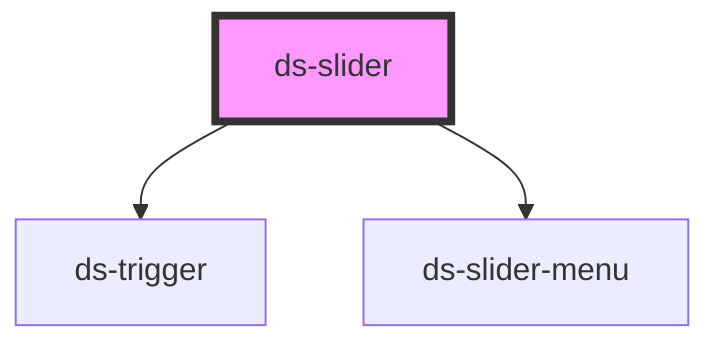

# ds-slider

## Styling

- **Classes**: `<ds-slider>` renders a `div` with the main class, `ds-slider`, its modifiers, and the state classes: `--hrt` or `--vtc` (`params.orientation`), `--playing` or `--paused` (the automatic rotation is on, or stopped), `--scrollable` (the items overflow), `--draggable`, `--isReady` (measured), `--transition` (while it slides).
- **Elements**: `__container` (clips the list), `__list` (the default slot, the `ds-slider-item` elements; `--sliding` while it slides, and the class of its orientation, `hrt` or `vtc`), `__prev-button` and `__next-button` (`ds-trigger` elements with the `ds-button --slider --prev` / `--next` classes, rendered when the items overflow and `params.controls` is set), `__rotation-button` (with `params.autoplay`: a `ds-trigger` with the `ds-button --slider --pause` classes while the slides rotate, `--play` once the rotation is stopped), and a `ds-slider-menu` with `params.menu`.
- **Attributes** (reflected): `slider-id`, `params`, `type`, `mods`. The slider also sets the role and ARIA attributes of its `div`, `aria-live` on `__list`, and `role`, `aria-roledescription`, `aria-label` and `inert` on the slides (see [Accessibility](#accessibility)).
- **Structure** (`slider.scss`): the items are a flex row (a column with `--vtc`) in the container, which clips it; the slider measures them and writes the sizes and the transform of a slide as inline styles. A slide is a `transform` transition of `--ds-slider-transition-duration` on the list: the slider ends it on its `transitionend` event, at once when it does not slide (a duration of 0, `transition: none`), or once its duration is over when the event does not come. With less motion (`prefers-reduced-motion: reduce`), the list does not slide (no transition, also without the theme): the slides change at once. The previous / next buttons are over the sides of the slider, vertically centered, `--ds-slider-button-offset` from the edges; the rotation button in its bottom left corner, at the same distance.
- **Look** (default theme, `components/_slider.scss`): round previous / next buttons with a chevron, and a rotation button with two bars (stop) or a triangle (start), from the custom properties below, set on `ds-slider`. The other colors of the buttons come from the button skin (`ds-trigger`). The dots of the menu: see `ds-slider-menu`.

Override them after the theme stylesheet (see [Styling a component](../../../README.md#styling-a-component)):

```css
ds-slider {
  --ds-slider-button-size: 2.5rem;
  --ds-slider-button-offset: 0;
}
```

## Accessibility

The slider follows the [WAI-ARIA carousel pattern](https://www.w3.org/WAI/ARIA/apg/patterns/carousel/), with previous / next buttons and, with `params.menu`, a slide picker made of buttons (a carousel whose slides are not tab panels: several can be in view).

- **Carousel**: the `div` of the slider is a `region` with `aria-roledescription="carousel"`, named by `label` (`aria-label`, required: what the slides are, "Featured products"), which holds the buttons, the slides and the menu.
- **Slides**: each `ds-slider-item` is a `group` (or keeps the `role` it has) with `aria-roledescription="slide"`, named by its place: "2 of 5" (`labels.slideName`), unless it has an `aria-label` of its own. A slide is numbered from its place the first time the slider sees it; the copies the slider makes for the loop keep the number and the name of their slide.
- **Slides out of view**: inert (out of the Tab order and of the accessibility tree): Tab goes from the previous button to the slides in view, then to the next button. The slides that come in view are no longer inert when the slide starts, those that leave are inert at once.
- **Buttons**: the previous and next buttons are `ds-trigger` buttons (`role="button"`, in the Tab order, Enter and Space), named "Previous slide" and "Next slide" (`labels.previous`, `labels.next`). Without `loop`, the previous button is not rendered on the first slide, the next one on the last: when one of them had the focus, the focus goes to the other one.
- **Live region**: the list of slides is a polite live region (`aria-live="polite"`): a screen reader reads the slides that come in view after a button or a dot. While the slides rotate on their own, it is `aria-live="off"`.
- **Automatic rotation** (`params.autoplay`): the slider renders a rotation button, first in the Tab order of the slider, named "Stop automatic slide show" while the slides rotate and "Start automatic slide show" once stopped (`labels.pause`, `labels.play`). The rotation stops when the focus enters the slider (from outside of it) and starts again only from that button (or `play()`); it pauses while the pointer is over the slider, and goes on when it leaves. `stop()` and `play()` stop and start it.
- **Less motion** (`prefers-reduced-motion: reduce`): the automatic rotation does not start (the rotation button can start it), and the slides change at once, without sliding.
- **Texts**: `labels` translates the texts read by assistive technologies (JSON as an attribute), each with an English default:

  | Key         | Default                      | What it is                                                            |
  | ----------- | ---------------------------- | --------------------------------------------------------------------- |
  | `carousel`  | `carousel`                   | `aria-roledescription` of the slider                                  |
  | `slide`     | `slide`                      | `aria-roledescription` of a slide                                     |
  | `slideName` | `{index} of {count}`         | Name of a slide: `{index}` its number, `{count}` the number of slides |
  | `previous`  | `Previous slide`             | Name of the previous button                                           |
  | `next`      | `Next slide`                 | Name of the next button                                               |
  | `play`      | `Start automatic slide show` | Name of the rotation button once the rotation is stopped              |
  | `pause`     | `Stop automatic slide show`  | Name of the rotation button while the slides rotate                   |
  | `menu`      | `Choose a slide`             | Name of the menu (`params.menu`)                                      |
  | `menuItem`  | `Slide {index}`              | Name of a dot of the menu                                             |

```html
<ds-slider label="Featured products" params='{"menu": true, "autoplay": true}'>
  <ds-slider-item><a href="/sofa"></a></ds-slider-item>
  <ds-slider-item><a href="/lamp"></a></ds-slider-item>
</ds-slider>

<ds-slider label="Produits" labels='{"slideName": "{index} sur {count}", "previous": "Diapositive précédente", "next": "Diapositive suivante"}'>…</ds-slider>
```

**Changed**: `label`, `labels`, the roles and names, the inert slides, the live region and the rotation button are new; `stop()` stops the rotation at once (it let one more slide go) and `play()` starts it again (it did not); the slider no longer hangs when the slide does not run (it only ended on `transitionend`); the index of the current slide goes round the slides (`prev()` from the first one gave `-1`); the previous and next buttons are named "Previous slide" and "Next slide" (they were "Previous image" and "Next image").

<!-- Auto Generated Below -->


## Overview

A carousel (WAI-ARIA carousel pattern): its slides (`ds-slider-item`) slide in a row, moved by the previous and next
buttons, the dots of its menu (`params.menu`), a swipe, or the automatic rotation (`params.autoplay`).
The slider is a `region` (`aria-roledescription="carousel"`) named by `label`; each slide a `group`
(`aria-roledescription="slide"`) named "2 of 5"; the slides out of view are inert. With the automatic rotation, the
slider renders a button that stops and starts it, first in the Tab order; the rotation stops when the focus enters the
slider, and pauses while the pointer is over it; it does not start with less motion. The list of slides is a polite
live region (`aria-live`) but while it rotates. The texts read by assistive technologies are `labels`.

## Properties

| Property   | Attribute   | Description                                                                                                                                                                                                                                                                                                                                                                                                  | Type                       | Default                     |
| ---------- | ----------- | ------------------------------------------------------------------------------------------------------------------------------------------------------------------------------------------------------------------------------------------------------------------------------------------------------------------------------------------------------------------------------------------------------------ | -------------------------- | --------------------------- |
| `label`    | `label`     | The accessible name of the carousel (`aria-label`): what its slides are ("Featured products").                                                                                                                                                                                                                                                                                                               | `string`                   | `undefined`                 |
| `labels`   | `labels`    | The texts read by assistive technologies, to translate them (JSON as an attribute): `carousel` and `slide` (the `aria-roledescription` of the slider and of a slide), `slideName` (the name of a slide, `{index} of {count}`), `previous`, `next`, `play`, `pause` (the names of the buttons), `menu` and `menuItem` (the names of the menu and of a dot, `Slide {index}`). Each one has an English default. | `DSSliderLabels \| string` | `{}`                        |
| `mods`     | `mods`      | Comma-separated list (or array) of modifiers, rendered as `--<modifier>` classes on the component.                                                                                                                                                                                                                                                                                                           | `string \| string[]`       | `[]`                        |
| `params`   | `params`    |                                                                                                                                                                                                                                                                                                                                                                                                              | `DSSliderParams \| string` | `{}`                        |
| `sliderId` | `slider-id` |                                                                                                                                                                                                                                                                                                                                                                                                              | `string`                   | `` `slide-${sliderId++}` `` |
| `type`     | `type`      |                                                                                                                                                                                                                                                                                                                                                                                                              | `string`                   | `'sld'`                     |


## Events

| Event         | Description | Type                                                                        |
| ------------- | ----------- | --------------------------------------------------------------------------- |
| `sliderEvent` |             | `CustomEvent<{ slide: string; direction: number; currentIndex?: number; }>` |


## Methods

### `goTo(itemIndex: number) => Promise<void>`


#### Parameters

| Name        | Type     | Description |
| ----------- | -------- | ----------- |
| `itemIndex` | `number` |             |

#### Returns

Type: `Promise<void>`


### `initialize() => Promise<void>`


#### Returns

Type: `Promise<void>`


### `next(step?: number, startPosition?: number) => Promise<void>`


#### Parameters

| Name            | Type     | Description |
| --------------- | -------- | ----------- |
| `step`          | `number` |             |
| `startPosition` | `number` |             |

#### Returns

Type: `Promise<void>`


### `play() => Promise<void>`

Starts the automatic rotation again (`params.autoplay`), unless the pointer is over the slider (it then starts when it leaves).

#### Returns

Type: `Promise<void>`


### `pointerDownHandler(event: TouchEvent) => Promise<void>`


#### Parameters

| Name    | Type         | Description |
| ------- | ------------ | ----------- |
| `event` | `TouchEvent` |             |

#### Returns

Type: `Promise<void>`


### `pointerMoveHandler() => Promise<void>`


#### Returns

Type: `Promise<void>`


### `pointerUpHandler(event: TouchEvent) => Promise<void>`


#### Parameters

| Name    | Type         | Description |
| ------- | ------------ | ----------- |
| `event` | `TouchEvent` |             |

#### Returns

Type: `Promise<void>`


### `prev(step?: number, startPosition?: number) => Promise<void>`


#### Parameters

| Name            | Type     | Description |
| --------------- | -------- | ----------- |
| `step`          | `number` |             |
| `startPosition` | `number` |             |

#### Returns

Type: `Promise<void>`


### `refresh(reset?: boolean) => Promise<void>`


#### Parameters

| Name    | Type      | Description |
| ------- | --------- | ----------- |
| `reset` | `boolean` |             |

#### Returns

Type: `Promise<void>`


### `reset() => Promise<void>`


#### Returns

Type: `Promise<void>`


### `stop() => Promise<void>`

Stops the automatic rotation (`params.autoplay`): the rotation button then starts it.

#### Returns

Type: `Promise<void>`


## Slots

| Slot | Description                    |
| ---- | ------------------------------ |
|      | The `ds-slider-item` elements. |


## CSS Custom Properties

| Name                              | Description                                                               |
| --------------------------------- | ------------------------------------------------------------------------- |
| `--ds-slider-button-background`   | Background of the previous / next buttons.                                |
| `--ds-slider-button-border-color` | Border color of the previous / next buttons.                              |
| `--ds-slider-button-offset`       | Distance between the previous / next buttons and the sides of the slider. |
| `--ds-slider-button-size`         | Width and height of the previous / next buttons.                          |
| `--ds-slider-transition-duration` | Duration of a slide.                                                      |


## Dependencies

### Depends on

- [ds-trigger](../trigger)
- [ds-slider-menu](slider-menu)

### Graph


----------------------------------------------

*Built with [StencilJS](https://stenciljs.com/)*
