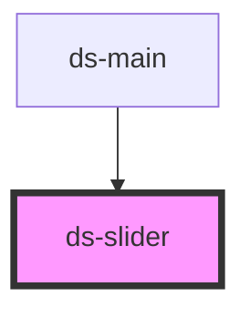

# ds-slider

<!-- Auto Generated Below -->

## Properties

| Property | Attribute | Description | Type                       | Default |
| -------- | --------- | ----------- | -------------------------- | ------- |
| `mods`   | `mods`    |             | `string \| string[]`       | `[]`    |
| `params` | `params`  |             | `DSSliderParams \| string` | `{}`    |
| `type`   | `type`    |             | `string`                   | `"sld"` |

## Events

| Event         | Description | Type                                                                        |
| ------------- | ----------- | --------------------------------------------------------------------------- |
| `sliderEvent` |             | `CustomEvent<{ slide: string; direction: number; currentIndex?: number; }>` |

## Methods

### `next(step?: number) => Promise<void>`

#### Parameters

| Name   | Type     | Description |
| ------ | -------- | ----------- |
| `step` | `number` |             |

#### Returns

Type: `Promise<void>`

### `play() => Promise<void>`

#### Returns

Type: `Promise<void>`

### `prev(step?: number) => Promise<void>`

#### Parameters

| Name   | Type     | Description |
| ------ | -------- | ----------- |
| `step` | `number` |             |

#### Returns

Type: `Promise<void>`

### `refresh(reset: boolean) => Promise<void>`

#### Parameters

| Name    | Type      | Description |
| ------- | --------- | ----------- |
| `reset` | `boolean` |             |

#### Returns

Type: `Promise<void>`

### `stop() => Promise<void>`

#### Returns

Type: `Promise<void>`

## Dependencies

### Used by

 - [ds-main](../..)

### Graph

----------------------------------------------

*Built with [StencilJS](https://stenciljs.com/)*
