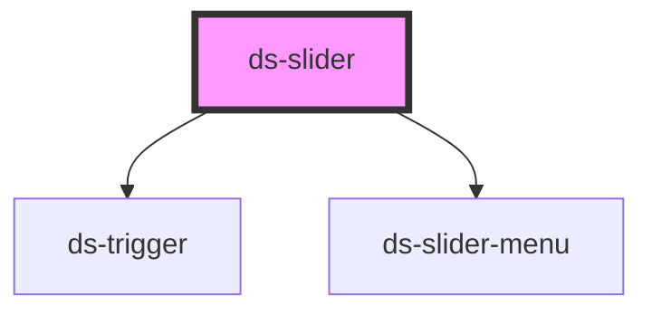

# ds-slider

<!-- Auto Generated Below -->

## Properties

| Property   | Attribute   | Description | Type                       | Default                 |
| ---------- | ----------- | ----------- | -------------------------- | ----------------------- |
| `mods`     | `mods`      |             | `string \| string[]`       | `[]`                    |
| `params`   | `params`    |             | `DSSliderParams \| string` | `{}`                    |
| `sliderId` | `slider-id` |             | `string`                   | ``slide-${sliderId++}`` |
| `type`     | `type`      |             | `string`                   | `"sld"`                 |

## Events

| Event         | Description | Type                                                                        |
| ------------- | ----------- | --------------------------------------------------------------------------- |
| `sliderEvent` |             | `CustomEvent<{ slide: string; direction: number; currentIndex?: number; }>` |

## Methods

### `goTo(itemIndex: number) => Promise<void>`

#### Parameters

| Name        | Type     | Description |
| ----------- | -------- | ----------- |
| `itemIndex` | `number` |             |

#### Returns

Type: `Promise<void>`

### `initialize() => Promise<void>`

#### Returns

Type: `Promise<void>`

### `next(step?: number, startPosition?: number) => Promise<void>`

#### Parameters

| Name            | Type     | Description |
| --------------- | -------- | ----------- |
| `step`          | `number` |             |
| `startPosition` | `number` |             |

#### Returns

Type: `Promise<void>`

### `play() => Promise<void>`

#### Returns

Type: `Promise<void>`

### `pointerDownHandler(event: PointerEvent) => Promise<void>`

#### Parameters

| Name    | Type           | Description |
| ------- | -------------- | ----------- |
| `event` | `PointerEvent` |             |

#### Returns

Type: `Promise<void>`

### `pointerMoveHandler() => Promise<void>`

#### Returns

Type: `Promise<void>`

### `pointerUpHandler(event: PointerEvent) => Promise<void>`

#### Parameters

| Name    | Type           | Description |
| ------- | -------------- | ----------- |
| `event` | `PointerEvent` |             |

#### Returns

Type: `Promise<void>`

### `prev(step?: number, startPosition?: number) => Promise<void>`

#### Parameters

| Name            | Type     | Description |
| --------------- | -------- | ----------- |
| `step`          | `number` |             |
| `startPosition` | `number` |             |

#### Returns

Type: `Promise<void>`

### `refresh(reset?: boolean) => Promise<void>`

#### Parameters

| Name    | Type      | Description |
| ------- | --------- | ----------- |
| `reset` | `boolean` |             |

#### Returns

Type: `Promise<void>`

### `reset() => Promise<void>`

#### Returns

Type: `Promise<void>`

### `stop() => Promise<void>`

#### Returns

Type: `Promise<void>`

## Dependencies

### Depends on

- [ds-trigger](../../core/trigger)
- [ds-slider-menu](slider-menu)

### Graph

----------------------------------------------

*Built with [StencilJS](https://stenciljs.com/)*
