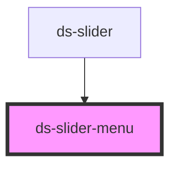

# ds-slider-menu

## Styling

- **Classes**: `<ds-slider-menu>` renders a `ul` with the class `ds-slider-menu`. Its elements: `__item`, a dot per item of the slider (`--active` for the current one; a click shows its item), and `__label`, the index of the item in the dot (hidden).
- **Attributes** (reflected): `itemCount`, `currentItemIndex`.
- **Structure** (`slider-menu.scss`): a centered flex row, pulled up over the bottom of the slider by `--ds-slider-menu-offset` (`-4rem` without a theme) and above it (`z-index: 1000`); the dots take the pointer and the labels are hidden.
- **Look** (default theme, `components/_slider.scss`): round dots, from the custom properties below, set on `ds-slider-menu`.

Override them after the theme stylesheet (see [Styling a component](../../../../README.md#styling-a-component)):

```css
ds-slider-menu {
  --ds-slider-menu-dot-color: var(--ds-color-gray-light);
  --ds-slider-menu-dot-active-color: var(--ds-color-primary-base);
}
```

<!-- Auto Generated Below -->


## Properties

| Property             | Attribute          | Description | Type     | Default |
| -------------------- | ------------------ | ----------- | -------- | ------- |
| `dsCurrentItemIndex` | `currentitemindex` |             | `number` | `0`     |
| `dsItemCount`        | `itemcount`        |             | `number` | `0`     |


## Events

| Event                             | Description | Type               |
| --------------------------------- | ----------- | ------------------ |
| `request_displaySliderItem_event` |             | `CustomEvent<any>` |


## CSS Custom Properties

| Name                                | Description                                                                              |
| ----------------------------------- | ---------------------------------------------------------------------------------------- |
| `--ds-slider-menu-dot-active-color` | Color of the dot of the current item (`--active`).                                       |
| `--ds-slider-menu-dot-color`        | Color of a dot.                                                                          |
| `--ds-slider-menu-dot-gap`          | Space on each side of a dot.                                                             |
| `--ds-slider-menu-dot-size`         | Width and height of a dot.                                                               |
| `--ds-slider-menu-offset`           | Vertical offset of the menu from its place below the slider (negative: over the slider). |


## Dependencies

### Used by

 - [ds-slider](..)

### Graph


----------------------------------------------

*Built with [StencilJS](https://stenciljs.com/)*
