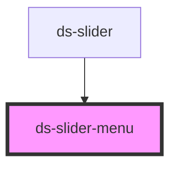

# ds-slider-menu

## Styling

- **Classes**: `<ds-slider-menu>` renders a `ul` with the class `ds-slider-menu`. Its elements: `__item`, a dot per item of the slider (`--active` for the current one), which holds `__button` (a native button, as large as the dot: a click shows its item), which holds `__label`, the index of the item (hidden).
- **Attributes** (reflected): `itemCount`, `currentItemIndex`.
- **Structure** (`slider-menu.scss`): a centered flex row, pulled up over the bottom of the slider by `--ds-slider-menu-offset` (`-4rem` without a theme) and above it (`z-index: 1000`); the dots take the pointer and the labels are hidden. The button fills its dot and draws nothing: no border, no background, the radius of the dot (`inherit`).
- **Look** (default theme, `components/_slider.scss`): round dots, from the custom properties below, set on `ds-slider-menu`. The focus indicator of the theme draws around the button of the dot, round.

Override them after the theme stylesheet (see [Styling a component](../../../../README.md#styling-a-component)):

```css
ds-slider-menu {
  --ds-slider-menu-dot-color: var(--ds-color-gray-light);
  --ds-slider-menu-dot-active-color: var(--ds-color-primary-base);
}
```

## Accessibility

- **Slide picker** (WAI-ARIA carousel pattern, with buttons): the list is named by `label` ("Choose a slide"); each dot is a native `button` (in the Tab order, Enter and Space), named by `item-label` ("Slide 2": `{index}` is the number of its slide, `{count}` the number of slides); the button of the current slide has `aria-current="true"`. The focus stays on the button after a click.
- `ds-slider` renders the menu with `params.menu` and gives it its texts (`labels.menu`, `labels.menuItem`).

**Changed**: the dots hold a native button (they were `li` elements with a click listener, which the keyboard could not reach); `label` and `item-label` are new.

<!-- Auto Generated Below -->


## Overview

The menu of `ds-slider` (`params.menu`): a list of dots, one per slide, each one a button that shows its slide. The
list is named by `label`, each button by `item-label` ("Slide 2"); the button of the current slide has
`aria-current="true"`. `ds-slider` renders it and gives it its texts (its `labels`).

## Properties

| Property             | Attribute          | Description                                                                                         | Type     | Default            |
| -------------------- | ------------------ | --------------------------------------------------------------------------------------------------- | -------- | ------------------ |
| `dsCurrentItemIndex` | `currentitemindex` |                                                                                                     | `number` | `0`                |
| `dsItemCount`        | `itemcount`        |                                                                                                     | `number` | `0`                |
| `itemLabel`          | `item-label`       | The accessible name of a dot: `{index}` is the number of its slide, `{count}` the number of slides. | `string` | `'Slide {index}'`  |
| `label`              | `label`            | The accessible name of the menu (`aria-label` of its list).                                         | `string` | `'Choose a slide'` |


## Events

| Event                             | Description | Type               |
| --------------------------------- | ----------- | ------------------ |
| `request_displaySliderItem_event` |             | `CustomEvent<any>` |


## CSS Custom Properties

| Name                                | Description                                                                              |
| ----------------------------------- | ---------------------------------------------------------------------------------------- |
| `--ds-slider-menu-dot-active-color` | Color of the dot of the current item (`--active`).                                       |
| `--ds-slider-menu-dot-color`        | Color of a dot.                                                                          |
| `--ds-slider-menu-dot-gap`          | Space on each side of a dot.                                                             |
| `--ds-slider-menu-dot-size`         | Width and height of a dot.                                                               |
| `--ds-slider-menu-offset`           | Vertical offset of the menu from its place below the slider (negative: over the slider). |


## Dependencies

### Used by

 - [ds-slider](..)

### Graph


----------------------------------------------

*Built with [StencilJS](https://stenciljs.com/)*
