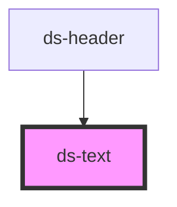

# ds-text

<!-- Auto Generated Below -->

## Properties

| Property    | Attribute   | Description | Type                 | Default     |
| ----------- | ----------- | ----------- | -------------------- | ----------- |
| `bold`      | `bold`      |             | `boolean`            | `undefined` |
| `color`     | `color`     |             | `string`             | `undefined` |
| `highlight` | `highlight` |             | `boolean`            | `undefined` |
| `italic`    | `italic`    |             | `boolean`            | `undefined` |
| `mods`      | `mods`      |             | `string \| string[]` | `"default"` |
| `size`      | `size`      |             | `number \| string`   | `undefined` |
| `type`      | `type`      |             | `string`             | `"p"`       |

## Dependencies

### Used by

 - [ds-header](../header)

### Graph

----------------------------------------------

*Built with [StencilJS](https://stenciljs.com/)*
