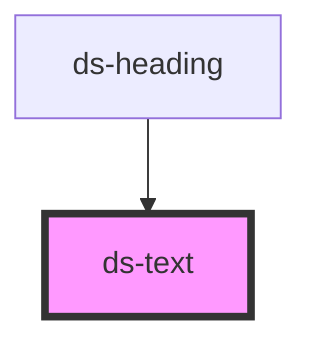

# ds-text

<!-- Auto Generated Below -->

## Properties

| Property | Attribute | Description                                                                                        | Type                                                  | Default     |
| -------- | --------- | -------------------------------------------------------------------------------------------------- | ----------------------------------------------------- | ----------- |
| `inline` | `inline`  |                                                                                                    | `boolean`                                             | `undefined` |
| `mods`   | `mods`    | Comma-separated list (or array) of modifiers, rendered as `--<modifier>` classes on the component. | `string \| string[]`                                  | `[]`        |
| `sub`    | `sub`     |                                                                                                    | `boolean`                                             | `undefined` |
| `sup`    | `sup`     |                                                                                                    | `boolean`                                             | `undefined` |
| `type`   | `type`    |                                                                                                    | `"code" \| "p" \| "quote"`                            | `'p'`       |
| `weight` | `weight`  |                                                                                                    | `"bold" \| "bolder" \| "light" \| "normal" \| "thin"` | `undefined` |

## Dependencies

### Used by

 - [ds-heading](../heading)

### Graph

----------------------------------------------

*Built with [StencilJS](https://stenciljs.com/)*
