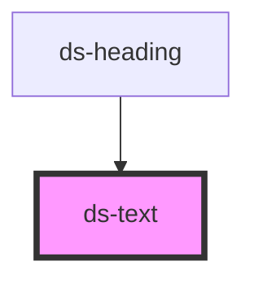

# ds-text

## Styling

- **Classes**: `ds-text` on `<ds-text>`; `mods` → `--<mod>`. The `type`, `inline`, `sup`, `sub` and `weight` props are neither reflected nor rendered as classes: no style reads them.
- **Slots**: the default slot, text, paragraphs and lists.
- **Structure** (`text.scss`): a block element.
- **Look** (default theme, `components/_text.scss`): the paragraph font style (`text` `paragraph`), and the spacing of the paragraphs and lists, from the custom properties below, set on `ds-text`.

Override them after the theme stylesheet (see [Styling a component](../../../README.md#styling-a-component)):

```css
ds-text {
  --ds-text-line-height: 1.75;
  --ds-text-spacing: var(--ds-space-4);
}
```

<!-- Auto Generated Below -->


## Overview

A block of text, in the paragraph font style of the theme.

## Properties

| Property | Attribute | Description                                                                                        | Type                                                  | Default     |
| -------- | --------- | -------------------------------------------------------------------------------------------------- | ----------------------------------------------------- | ----------- |
| `inline` | `inline`  |                                                                                                    | `boolean`                                             | `undefined` |
| `mods`   | `mods`    | Comma-separated list (or array) of modifiers, rendered as `--<modifier>` classes on the component. | `string \| string[]`                                  | `[]`        |
| `sub`    | `sub`     |                                                                                                    | `boolean`                                             | `undefined` |
| `sup`    | `sup`     |                                                                                                    | `boolean`                                             | `undefined` |
| `type`   | `type`    |                                                                                                    | `"code" \| "p" \| "quote"`                            | `'p'`       |
| `weight` | `weight`  |                                                                                                    | `"bold" \| "bolder" \| "light" \| "normal" \| "thin"` | `undefined` |


## Slots

| Slot | Description                               |
| ---- | ----------------------------------------- |
|      | The text: paragraphs, lists, inline text. |


## CSS Custom Properties

| Name                    | Description                                                      |
| ----------------------- | ---------------------------------------------------------------- |
| `--ds-text-font-family` | Font family of the text.                                         |
| `--ds-text-font-size`   | Font size of the text.                                           |
| `--ds-text-line-height` | Line height of the text.                                         |
| `--ds-text-list-indent` | Indent of the lists.                                             |
| `--ds-text-spacing`     | Space below each paragraph and list (none below the last child). |


## Dependencies

### Used by

 - [ds-heading](../heading)

### Graph


----------------------------------------------

*Built with [StencilJS](https://stenciljs.com/)*
