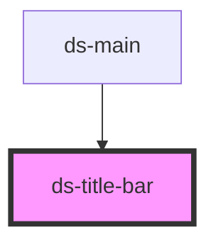

# ds-title-bar

<!-- Auto Generated Below -->

## Properties

| Property | Attribute | Description | Type                 | Default     |
| -------- | --------- | ----------- | -------------------- | ----------- |
| `ctx`    | `ctx`     |             | `boolean`            | `undefined` |
| `mods`   | `mods`    |             | `string \| string[]` | `[]`        |

## Dependencies

### Used by

 - [ds-main](../../demo)

### Graph

----------------------------------------------

*Built with [StencilJS](https://stenciljs.com/)*
