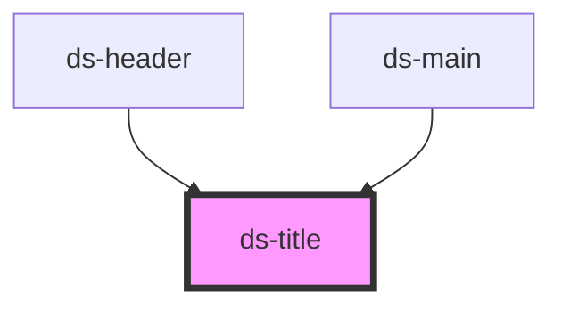

# ds-title

<!-- Auto Generated Below -->

## Properties

| Property  | Attribute | Description | Type                 | Default     |
| --------- | --------- | ----------- | -------------------- | ----------- |
| `block`   | `block`   |             | `boolean`            | `undefined` |
| `mods`    | `mods`    |             | `string \| string[]` | `[]`        |
| `page`    | `page`    |             | `boolean`            | `undefined` |
| `section` | `section` |             | `boolean`            | `undefined` |
| `sub`     | `sub`     |             | `boolean`            | `undefined` |

## Dependencies

### Used by

 - [ds-header](../header)
 - [ds-main](../..)

### Graph

----------------------------------------------

*Built with [StencilJS](https://stenciljs.com/)*
