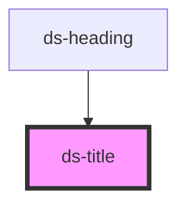

# ds-title

## Styling

- **Classes**: `ds-title` on `<ds-title>`; `mods` → `--<mod>`.
- **Attributes** (reflected): `page`, `section`, `block` and `sub` give the variant the default theme styles (a section title without any of them; `sub` for a subtitle of the same level); `sup`, `article` and `form` are reflected too, without a style of their own in the default theme.
- **Slots**: the default slot, text or a heading (`h1`…`h6`), a paragraph, a link or a `strong`.
- **Structure** (`title.scss`): a block element. The headings, paragraphs, links and `strong` elements inside it lose their margins and paddings and inherit the font size, weight, line height and color of the title (a link and a `strong` are blocks).
- **Look** (default theme, `components/_title.scss`): each variant takes its font size and weight from the title font styles (`--ds-font-style-title-<variant>-size`, `-weight`), and the color, font family and line height from the custom properties below, set on `ds-title`.

Override them after the theme stylesheet (see [Styling a component](../../../README.md#styling-a-component)):

```css
ds-title {
  --ds-title-font-family: Georgia, serif;
}

.dark ds-title {
  --ds-title-color: var(--ds-color-gray-white);
  --ds-title-sub-color: var(--ds-color-gray-light);
}
```

## Accessibility

- **Heading**: `ds-title` renders no heading element of its own, and its variants (`page`, `section`, `block`, `sub`) are its look only. Put a heading of the right level in it (`<ds-title section><h2>…</h2></ds-title>`): it keeps its semantics (the stylesheet resets its margins and typography). For a text title, `level` (1 to 6) makes the element a heading (`role="heading"`, `aria-level`); it is ignored when the title holds a heading element, which has its own level.
- A title that is not a heading (a label, a tagline) needs neither.

```html
<ds-title page><h1>Our products</h1></ds-title>
<ds-title block level="3">Delivery</ds-title>
```

**Changed**: `level` is new.

<!-- Auto Generated Below -->


## Overview

A title, styled by the theme (`page`, `section`, `block`, `sub`). It renders no heading of its own: put a heading
(`h1`…`h6`) in it, or set `level` to make a text title a heading (`role="heading"`, `aria-level`).

## Properties

| Property  | Attribute | Description                                                                                                                                                                         | Type                 | Default     |
| --------- | --------- | ----------------------------------------------------------------------------------------------------------------------------------------------------------------------------------- | -------------------- | ----------- |
| `article` | `article` |                                                                                                                                                                                     | `boolean`            | `undefined` |
| `block`   | `block`   |                                                                                                                                                                                     | `boolean`            | `undefined` |
| `form`    | `form`    |                                                                                                                                                                                     | `boolean`            | `undefined` |
| `level`   | `level`   | The heading level (1 to 6) of a text title: the element is a heading (`role="heading"`, `aria-level`). Not applied when the title holds a heading element, which has its own level. | `number \| string`   | `undefined` |
| `mods`    | `mods`    | Comma-separated list (or array) of modifiers, rendered as `--<modifier>` classes on the component.                                                                                  | `string \| string[]` | `[]`        |
| `page`    | `page`    |                                                                                                                                                                                     | `boolean`            | `undefined` |
| `section` | `section` |                                                                                                                                                                                     | `boolean`            | `undefined` |
| `sub`     | `sub`     |                                                                                                                                                                                     | `boolean`            | `undefined` |
| `sup`     | `sup`     |                                                                                                                                                                                     | `boolean`            | `undefined` |


## Slots

| Slot | Description                                                         |
| ---- | ------------------------------------------------------------------- |
|      | The title: a text, or a heading, a paragraph, a link or a `strong`. |


## CSS Custom Properties

| Name                     | Description                                                         |
| ------------------------ | ------------------------------------------------------------------- |
| `--ds-title-color`       | Text color of the title.                                            |
| `--ds-title-font-family` | Font family of the titles (every variant: `page`, `block`, `sub`…). |
| `--ds-title-line-height` | Line height of the titles.                                          |
| `--ds-title-sub-color`   | Text color of a `sub` title.                                        |


## Dependencies

### Used by

 - [ds-heading](../heading)

### Graph


----------------------------------------------

*Built with [StencilJS](https://stenciljs.com/)*
