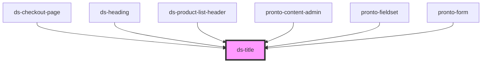

# ds-title

<!-- Auto Generated Below -->

## Properties

| Property     | Attribute     | Description | Type                 | Default     |
| ------------ | ------------- | ----------- | -------------------- | ----------- |
| `article`    | `article`     |             | `boolean`            | `undefined` |
| `block`      | `block`       |             | `boolean`            | `undefined` |
| `form`       | `form`        |             | `boolean`            | `undefined` |
| `mods`       | `mods`        |             | `string \| string[]` | `[]`        |
| `page`       | `page`        |             | `boolean`            | `undefined` |
| `section`    | `section`     |             | `boolean`            | `undefined` |
| `sub`        | `sub`         |             | `boolean`            | `undefined` |
| `sup`        | `sup`         |             | `boolean`            | `undefined` |
| `useContext` | `use-context` |             | `boolean`            | `undefined` |

## Dependencies

### Used by

 - [ds-checkout-page](../../pronto/checkout/checkout-page)
 - [ds-heading](../heading)
 - [ds-product-list-header](../../pronto/product-list-header)
 - [pronto-content-admin](../../pronto/pronto-content)
 - [pronto-fieldset](../../pronto/pronto-content/form/fieldset)
 - [pronto-form](../../pronto/pronto-content/form)

### Graph

----------------------------------------------

*Built with [StencilJS](https://stenciljs.com/)*
