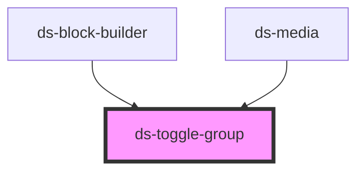

# ds-toggle-group

<!-- Auto Generated Below -->

## Properties

| Property   | Attribute  | Description | Type                 | Default     |
| ---------- | ---------- | ----------- | -------------------- | ----------- |
| `count`    | `count`    |             | `number[] \| string` | `[1, 1]`    |
| `disabled` | `disabled` |             | `boolean`            | `undefined` |
| `mods`     | `mods`     |             | `string \| string[]` | `[]`        |
| `name`     | `name`     |             | `string`             | `undefined` |
| `type`     | `type`     |             | `string`             | `undefined` |

## Events

| Event               | Description | Type               |
| ------------------- | ----------- | ------------------ |
| `toggleValueChange` |             | `CustomEvent<any>` |

## Dependencies

### Used by

 - [ds-block-builder](../../pronto/pronto-content/configurator/block-builder)
 - [ds-media](../../pronto/pronto-content/configurator/media)

### Graph

----------------------------------------------

*Built with [StencilJS](https://stenciljs.com/)*
