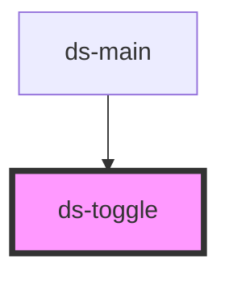

# ds-toggle

<!-- Auto Generated Below -->

## Properties

| Property   | Attribute  | Description | Type                          | Default     |
| ---------- | ---------- | ----------- | ----------------------------- | ----------- |
| `checked`  | `checked`  |             | `boolean`                     | `undefined` |
| `disabled` | `disabled` |             | `boolean`                     | `undefined` |
| `mods`     | `mods`     |             | `string \| string[]`          | `[]`        |
| `name`     | `name`     |             | `string`                      | `undefined` |
| `type`     | `type`     |             | `string`                      | `'switch'`  |
| `value`    | `value`    |             | `boolean \| number \| string` | `undefined` |

## Events

| Event    | Description | Type               |
| -------- | ----------- | ------------------ |
| `toggle` |             | `CustomEvent<any>` |

## Methods

### `setChecked(checked: boolean) => Promise<void>`

#### Parameters

| Name      | Type      | Description |
| --------- | --------- | ----------- |
| `checked` | `boolean` |             |

#### Returns

Type: `Promise<void>`

### `setName(name: string) => Promise<void>`

#### Parameters

| Name   | Type     | Description |
| ------ | -------- | ----------- |
| `name` | `string` |             |

#### Returns

Type: `Promise<void>`

### `setProps(properties: Record<string, unknown>) => Promise<void>`

#### Parameters

| Name         | Type                        | Description |
| ------------ | --------------------------- | ----------- |
| `properties` | `{ [x: string]: unknown; }` |             |

#### Returns

Type: `Promise<void>`

### `setType(type: "radio" | "icon" | "checkbox" | "switch" | string) => Promise<void>`

#### Parameters

| Name   | Type     | Description |
| ------ | -------- | ----------- |
| `type` | `string` |             |

#### Returns

Type: `Promise<void>`

## Dependencies

### Used by

 - [ds-main](../../demo)

### Graph

----------------------------------------------

*Built with [StencilJS](https://stenciljs.com/)*
